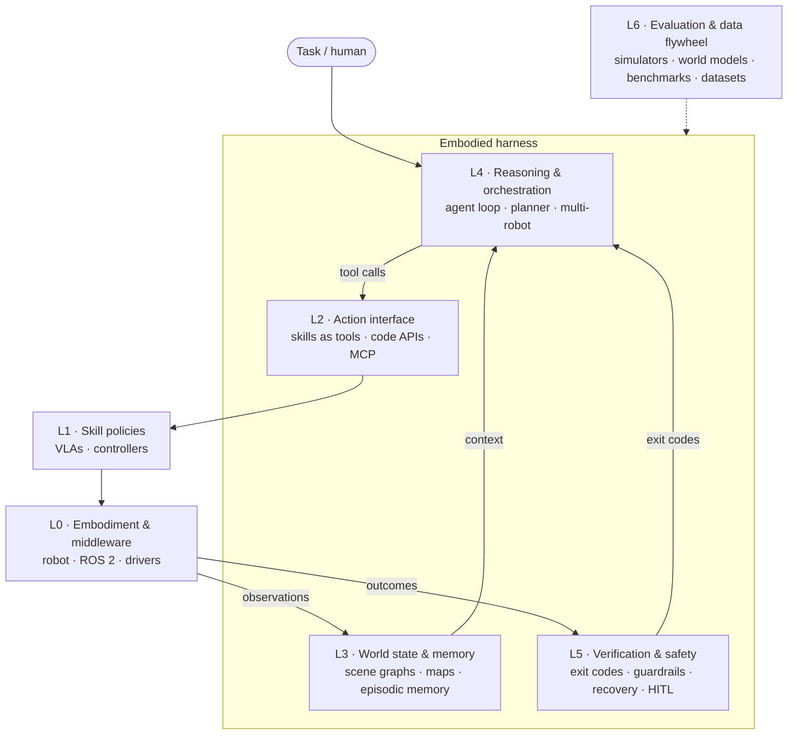

# Awesome Embodied Harness [](https://awesome.re)

<!-- BEGIN GENERATED: badges -->
   
<!-- END GENERATED: badges -->

> A curated, continuously updated survey of the **embodied harness** stack: everything around a foundation model that turns it into an agent acting in the physical world. A daily radar agent keeps it current.

Coding agents showed that the model is only half the system. Claude Code, Codex and their peers succeed or fail on their **harness**: the loop, the tools, context management, permissions, and tests used as exit codes. Robots are going through the same split. An **embodied harness** wraps an LLM, VLM, VLA or world model with:

- an **agent loop** that plans, calls tools, observes and replans;
- robot capabilities exposed as **tools**: skills, VLA policies, motion primitives, generated code;
- **world state as context**: scene graphs, maps, object and episodic memory;
- **exit codes**: success detection, failure diagnosis and recovery;
- a **safety envelope**: guardrails, permissions, human-in-the-loop;
- the **sim / eval / data flywheel** used to build and test all of the above.

This list covers every layer of that stack, not just the models. [SURVEY.md](SURVEY.md) has the taxonomy, a comparison of representative harnesses, and open problems.



**Legend:** 🟢 open (code, and weights for models) · 🟡 partial (e.g. weights or dataset only) · 🔵 API / product · ⚪ closed (paper, blog or demo only). Hover over a name to see the full paper title. The overview below shows the 10 newest entries of each category. Every category also has a full list page in [`categories/`](categories), grouped by year.

## Contents

<!-- BEGIN GENERATED: toc -->
- [Surveys & Position Papers](#survey) (90)
- [Embodied Harnesses](#harness) (193)
- [Open-Source Frameworks & Runtimes](#framework) (27)
- [Action Interfaces, Skills & Tool Protocols](#interface) (45)
- [World State, Memory & Spatial Context](#memory) (64)
- [Embodied Reasoning Models & Planners](#brain) (53)
- [VLA Models & Skill Policies](#policy) (98)
- [World Models](#world-model) (76)
- [Verification, Failure Detection & Recovery](#verification) (60)
- [Safety, Guardrails & Security](#safety) (59)
- [Multi-Robot & Fleet Orchestration](#multi-agent) (53)
- [Simulators & Environments](#sim) (51)
- [Benchmarks & Evaluation](#benchmark) (151)
- [Data, Teleoperation & Training Infrastructure](#data) (94)
<!-- END GENERATED: toc -->
- [Daily radar](#daily-radar) · [Recently added](#recently-added) · [Contributing](#contributing) · [Citation](#citation)

## Daily radar

Every day a scheduled agent scans arXiv, Hugging Face, GitHub, lab blogs and news. It checks each find against primary sources, adds qualifying systems to [`data/`](data), and writes a log to [`radar/log/`](radar/log). The procedure is in [radar/PLAYBOOK.md](radar/PLAYBOOK.md) and the watch list is in [radar/sources.yaml](radar/sources.yaml).

<!-- BEGIN GENERATED: radar -->
- [2026-10-23](radar/log/2026-10-23.md) — Harnesses that rewrite themselves: SERA evolves the harness around a VLM planner from rollouts, AW-0 puts code inside a world action model, and two surveys frame embodied agents by verify and self-improve (12 added, 8 candidates)
- [2026-10-22](radar/log/2026-10-22.md) — The harness becomes the variable: AgenticRoboRL post-trains the planner across harnesses, RoboColiseum finds harness design changes frontier-model success, and a runtime check stops the hazardous instructions a default control loop executes (12 added, 8 candidates)
- [2026-10-21](radar/log/2026-10-21.md) — Harness ideas spread to world models: State World Models keep explicit rule-governed state outside a frozen video model, and PhysRSI-eval starts measuring where physical self-improvement comes from (12 added)
- [2026-10-20](radar/log/2026-10-20.md) — Frontier models as robots, and multi-robot teams as code: SenseNova tests GPT-6-Astra across 12 embodied benchmarks, HexaShell keeps the harness thin, and InstAgent and CoEvolve make team coordination self-improving (12 added)
- [2026-10-19](radar/log/2026-10-19.md) — Monday maintenance: four papers renamed on arXiv (one substantially revised), one repository gone; no new arXiv listing yet (5 updated)
- [2026-10-18](radar/log/2026-10-18.md) — Quiet weekend: no new arXiv listing; EASG releases its zero-shot code, and nine other promised releases are still pending (1 updated)
- [2026-10-17](radar/log/2026-10-17.md) — Harnesses learn the user: CarryOn, PAM and LIBERO-PeRM make personalization and proactive help first-class; verification moves inside the action chunk (VeriVLA, PAV) (12 added)
<!-- END GENERATED: radar -->

## Recently added

<!-- BEGIN GENERATED: recent -->
Added in the 30 days up to 2026-10-23:

- 🟢 [**Multimodal Embodied Agents (PAPAV)**](https://arxiv.org/abs/2610.30108 "Multimodal Embodied Agents: A Unified Capability-centric Perspective from Computer-Use to Robot-Use") · 2026-10 — Survey framing computer-use and robot-use agents by five functions (perceive, anticipate, plan, act, verify) and asking what changes in the physical world; finds that most of 64 benchmarks evaluate acting, with few assessing anticipation or verification. [code](https://github.com/showlab/Awesome-Multimodal-Embodied-Agent) · [project](https://showlab.github.io/Awesome-Multimodal-Embodied-Agent/) _(added 2026-10-23 to [Surveys & Position Papers](#survey))_
- 🟢 [**Toward Recursive Self-Improvement in Physical AI**](https://arxiv.org/abs/2610.29677) · 2026-10 — 93-page position survey placing recursive self-improvement in robot learning: traces paths from improving robot capabilities to improving the processes that produce them, and states when physical gains can carry forward safely and affordably. [code](https://github.com/Physical2RSI/Awesome-Physical2RSI) · [project](https://physical2rsi.github.io/) _(added 2026-10-23 to [Surveys & Position Papers](#survey))_
- ⚪ [**SERA**](https://arxiv.org/abs/2610.29560 "From VLM Planners to Robotic Agents: Self-Evolving Harnesses for History-Dependent Manipulation") · 2026-10 — Self-Evolving Robotic Agent: a VLM planner runs inside an editable harness that keeps task context from observations and execution feedback over a fixed VLA executor, and environment rollouts propose and evaluate revisions to the harness itself. _(added 2026-10-23 to [Embodied Harnesses](#harness))_
- 🟢 [**TARSphere**](https://arxiv.org/abs/2610.30043 "TARSphere: A Robot-Oriented Full-Stack Framework for Long-Horizon Embodied Agents in Evolving Physical and Social Environments") · 2026-10 — Full stack for long-horizon embodied agents: simulator infrastructure with embodied NPCs and an event-driven FSM for task state, a harness letting a frozen MLLM act through multi-level skills with hierarchical memory, and a 360-episode benchmark. _Note: Real-robot support is still listed as TODO in the README._ [code](https://github.com/xuyicheng-zju/TARSphere) · [project](https://xuyicheng-zju.github.io/TARSphere/) _(added 2026-10-23 to [Open-Source Frameworks & Runtimes](#framework))_
- ⚪ [**PAL (Plan First, Act Later)**](https://arxiv.org/abs/2610.29329 "Plan First, Act Later: Streaming Reasoning for Executable Memory in Robot Control") · 2026-10 — Hierarchical memory in which a VLM turns streaming observations into a short-term visual buffer, semantic-event memory and an executable subtask list ahead of time, then hands the current subtask to a VLA, moving reasoning out of execution time. _Note: The repository linked from the project page did not resolve on 2026-10-23._ [project](https://qinghangliu.github.io/pal-webpage/) _(added 2026-10-23 to [World State, Memory & Spatial Context](#memory))_
- ⚪ [**GPT-as-Tactile-Policy**](https://arxiv.org/abs/2610.28457 "GPT-6-Astra Understands Touch and Outperform Vision--Tactile--Language--Action Models") · 2026-10 — Summarizes expert demonstrations into task guidance and tactile references so GPT-6 Astra can assess contact and correct actions from tactile feedback without robot-specific training; reports 93.8% mean success on five UniVTAC tasks (first-party). _Note: Project page says code is coming soon. Promoted from the queue._ [project](https://gpt-as-tactile-policy.github.io/) _(added 2026-10-23 to [Embodied Reasoning Models & Planners](#brain))_
- ⚪ [**ACE-Brain-0.6**](https://arxiv.org/abs/2610.27040 "ACE-Brain-0.6: Scaling Spatial Grounding for Physical Foundation Models") · 2026-10 — Successor to ACE-Brain-0.5 focused on spatial grounding: Qwen3.5-9B fine-tuned on about 1.5M verifiable grounding samples built from robot recordings and other visual data; reports a higher average than GPT-6 Astra on seven grounding benchmarks (first-party). _Note: Promoted from the queue._ _(added 2026-10-23 to [Embodied Reasoning Models & Planners](#brain))_
- 🟢 [**AW-0 (Agentic World Action Models)**](https://arxiv.org/abs/2610.30136 "Agentic World Action Models") · 2026-10 — Mixture-of-transformers world action model that jointly generates code, future video and robot actions: a code expert writes parameterized skill routines that structure prediction and are kept as reusable programs for agentic execution. [code](https://github.com/ZhuoyangLiu2005/agentic-wam) · [project](https://agentic-wam.github.io/) · [weights](https://huggingface.co/miniFranka/agentic-wam-pretrain-yamego3k-soup-e1) _(added 2026-10-23 to [World Models](#world-model))_
- 🟢 [**Post-hoc VLA epistemic uncertainty**](https://arxiv.org/abs/2610.29730 "Post-hoc Epistemic Uncertainty for Vision-Language-Action Policies") · 2026-10 — Kernel-variance heads fitted on a single VLA's embeddings estimate epistemic uncertainty without gradient updates; on SmolVLA/LIBERO-10 they match two-policy ensembles for predicting success, choosing demonstrations and deferring to a stronger supervisor. [code](https://github.com/post-hoc-vla-uncertainty/post-hoc-vla-uncertainty) _(added 2026-10-23 to [Verification, Failure Detection & Recovery](#verification))_
- ⚪ [**PACT-VLA**](https://arxiv.org/abs/2610.28019 "PACT-VLA: Speculative Action-Chunk Verification with Pre-Commit Observations") · 2026-10 — Training-free asynchronous VLA inference that uses inference delay as decision time: candidate chunks from the start observation are scored against a later pre-commit observation by the frozen policy's own flow residual (FlowRes). _Note: Promoted from the queue._ _(added 2026-10-23 to [Verification, Failure Detection & Recovery](#verification))_
- 🟢 [**LLM-LIBERO**](https://arxiv.org/abs/2610.30051 "From Reasoning to Action: Benchmarking Frontier AI Models on LIBERO-10 Robot Manipulation Tasks") · 2026-10 — Closed-loop tool-call framework in which frontier models set end-effector poses and gripper commands on LIBERO-10; six models at three reasoning-effort levels over 1,800 episodes, with GPT-6 Astra highest at 44% (first-party). [code](https://github.com/IRVLUTD/LLM_LIBERO) · [project](https://irvlutd.github.io/LLM-LIBERO/) _(added 2026-10-23 to [Benchmarks & Evaluation](#benchmark))_
- 🟢 [**HATCH**](https://arxiv.org/abs/2610.27485 "HATCH: Hardware-Attested Task Chains for Verifiable Manipulation") · 2026-10 — A physically replicable robot "escape room": chained tasks across five skill categories where the sensor confirming one task unlocks the next, scored by instrumentation, randomized by a run-day seed and submitted as attested self-runs. _Note: IROS 2026 Workshop on Open Robotics Software. Promoted from the queue._ [code](https://github.com/shizacharania/hatch-benchmark) _(added 2026-10-23 to [Benchmarks & Evaluation](#benchmark))_
- ⚪ [**AgenticRoboRL**](https://arxiv.org/abs/2610.28589 "AgenticRoboRL: Bringing Coding-Agent Post-Training to Agentic Robotics") · 2026-10 — Post-trains the planner of an agentic robot system with SFT plus multi-turn RL, using harness-specific adapters for VLA-skill and control-code harnesses; reports a 9B planner rising from 18.1% to 71.0% on LIBERO-PRO without external memory (first-party). _Note: Framework and planner checkpoints announced, not yet released._ _(added 2026-10-22 to [Embodied Harnesses](#harness))_
- 🟢 [**Tactile-ETA**](https://arxiv.org/abs/2610.27613 "Embodied Task Agents Can Perform Fine Manipulation through Tactile In-Context Learning") · 2026-10 — Adds tactile experience to an embodied task agent through in-context demonstrations that pair each robot movement with camera views and selected tactile frames; the agent acts through general robot tools without parameter updates. [code](https://github.com/No-518/Tactile-ETA) · [project](https://no-518.github.io/tactile-eta/) _(added 2026-10-22 to [Embodied Harnesses](#harness))_
- ⚪ [**FIT-MAC**](https://arxiv.org/abs/2610.28109 "FIT-MAC: A Closed-Loop Multi-Agent Framework for Robust Vision-Language-Action Models") · 2026-10 — Inference-time control layer around a VLA: planner, grounder, verifier and correction agents separate target-binding errors from local execution failures and route bounded recoveries, leaving the VLA as the default action generator. _(added 2026-10-22 to [Embodied Harnesses](#harness))_
- ⚪ [**Industrial ReMEmbR**](https://arxiv.org/abs/2610.28624 "Industrial ReMEmbR: Scaling Spatiotemporal Memory to Robot Fleets") · 2026-10 — Extends NVIDIA ReMEmbR to warehouse fleets: robots encode clips on-device into retrieval embeddings and cached vision tokens, people are masked for privacy, and a Nemotron agent queries memories by content, position and time, decoding descriptions only on demand. _(added 2026-10-22 to [World State, Memory & Spatial Context](#memory))_
- ⚪ [**EventSync**](https://arxiv.org/abs/2610.27917 "EventSync: Event-Driven Memory Updates for History-Dependent Manipulation") · 2026-10 — VLM-plus-VLA hierarchy where a lightweight event monitor confirms subgoal completion from vision and end-effector trajectories before the task memory is updated and the planner is re-invoked; reports 64.5% on RoboMME (first-party). _(added 2026-10-22 to [World State, Memory & Spatial Context](#memory))_
- ⚪ [**ERR-VLM (Replan for Error Recovery)**](https://arxiv.org/abs/2610.27003 "Replan for Error Recovery: Training Embodied VLMs through Verifiable Interaction with Action-Grouped Turn-GSPO") · 2026-10 — Builds ERR-Env and ERR-Bench, which give feedback on task progress and execution errors from nominal, intermediate and error states, and trains a 2B embodied VLM with turn-level online RL to replan after failures. _(added 2026-10-22 to [Embodied Reasoning Models & Planners](#brain))_
- ⚪ [**Refuses When Asked, Complies When Acting**](https://arxiv.org/abs/2610.27350 "Refuses When Asked, Complies When Acting: A Runtime Safety Check for Robot Control Loops") · 2026-10 — Shows GPT-6 Astra driving an SO-101 arm through the Inspect Robots harness attempted all 15 commonly-known-hazardous instructions; a pre-motion check asking the model whether it would carry out the instruction flagged all 15 and none of 15 controls (first-party). _Note: SPAIS workshop at CoRL 2026. The code repository named in the abstract did not resolve on 2026-10-22._ _(added 2026-10-22 to [Safety, Guardrails & Security](#safety))_
- ⚪ [**CAPSafe**](https://arxiv.org/abs/2610.28381 "CAPSafe: A Benchmark for Contextual Action and Plan Safety Reasoning in Embodied Agents") · 2026-10 — Tests LLM embodied agents on action-level safety (is this action safe in context) and plan-level safety for hazardous household tasks with co-occurring, severity-annotated hazards; nine models recognize hazards far better than they plan safely. _(added 2026-10-22 to [Safety, Guardrails & Security](#safety))_
- ⚪ [**RoboColiseum (Agent2Act)**](https://arxiv.org/abs/2610.27865 "Frontier LLMs Enter the World of Robotics: A Cross-Model Evaluation on RoboColiseum") · 2026-10 — Compares GPT-6 Astra, GPT-6.1 Sol, Claude Opus 5.5 and Gemini 4 Argon through one control harness (Agent2Act) on instruction following, spatial reasoning, manipulation and robustness tracks, and reports that harness design changes task success. _(added 2026-10-22 to [Benchmarks & Evaluation](#benchmark))_
- 🟢 [**Embodied Playground**](https://arxiv.org/abs/2610.27039 "Embodied Playground: A Long-Horizon Agentic Robotics Benchmark for Physical, Strategic, and Spatial Reasoning") · 2026-10 — 410 task environments (manipulation, sequential puzzles, multi-stage household tasks) for foundation-model agents, with a shared protocol for tool access, resource budgets, repeated trials and independent checks of goal completion, rule compliance and physical validity. [code](https://github.com/Winniechen2002/Embodied-Playground) · [project](https://winniechen2002.github.io/Agent-bench-website/) _(added 2026-10-22 to [Benchmarks & Evaluation](#benchmark))_
- ⚪ [**JARVIS**](https://arxiv.org/abs/2610.27618 "JARVIS: From Visual Manuals to Autonomous Robotic Assembly") · 2026-10 — Benchmark of 236,679 LEGO assembly tasks driven by visual manuals alone, with a 50-task interactive suite and structure-aware scoring; its JARVIS-agentic baseline composes robot primitives into programs and verifies them with execution feedback. _(added 2026-10-22 to [Benchmarks & Evaluation](#benchmark))_
- ⚪ [**GPT-6 as a Beginning (LIBERO-GeoMotion)**](https://arxiv.org/abs/2610.28259 "Large Multimodal Models for Direct Robot Control: GPT-6 as a Beginning") · 2026-10 — Evaluates GPT-6 Astra in a lightweight agent loop on depth use, in-context learning, tactile feedback and five manipulation benchmarks, and adds LIBERO-GeoMotion, geometry-constrained tasks exposing gaps in precision and consequence-aware planning. _(added 2026-10-22 to [Benchmarks & Evaluation](#benchmark))_
- ⚪ [**BetaMem**](https://arxiv.org/abs/2610.26554 "BetaMem: Learning to Remember a Changing World for Embodied Agents") · 2026-10 — Traceable long-term memory for embodied agents across six linked layers (working, spatial, entity, episodic, experiential, procedural) with a write contract learned by SFT and RL that rewards complete, accurate memory operations verified against the original observations. _(added 2026-10-21 to [World State, Memory & Spatial Context](#memory))_
- 🟡 [**VLDA**](https://arxiv.org/abs/2610.25874 "Vision-Language-Delta-Action: Learning Compact Deltas as Actionable Transition Interfaces for Robotic Manipulation") · 2026-10 — Reformulates future prediction in VLAs as compact, actionable transition deltas instead of full future states, using them as the interface between semantic understanding and action generation. _Note: Code provided as a cookbook in the LoongForge framework._ [code](https://github.com/baidu-baige/LoongForge/tree/master/cookbook/loongforge-vlda) _(added 2026-10-21 to [VLA Models & Skill Policies](#policy))_
- ⚪ [**ScaleNav**](https://arxiv.org/abs/2610.25690 "ScaleNav: Scalable Internet Video Pretraining for Language-Conditioned Local Navigation") · 2026-10 — World-action framework that learns goal-directed visual dynamics from internet egocentric videos and uses them to support robot action generation for language-conditioned local navigation. _(added 2026-10-21 to [VLA Models & Skill Policies](#policy))_
- ⚪ [**Stateful Harness (State World Models)**](https://arxiv.org/abs/2610.26811 "State World Models: Execute the Rules, Generate the Pixels") · 2026-10 — Separates world evolution from rendering: a stateful harness maintains an evolving world state under specified rules, renders each event with a frozen video model, and uses the generated clip to update state, so interactions follow persistent rules even when state is off-screen. _(added 2026-10-21 to [World Models](#world-model))_
- 🟢 [**Ropedia W0**](https://arxiv.org/abs/2610.26855 "Ropedia W0: Scaling Loco-Manipulation World Models across Embodiments with Human Experience") · 2026-10 — Egocentric loco-manipulation world foundation model across humans and robots, trained on Xp-Data (10k hours of human and 3k hours of robot egocentric data) with a unified kinematic representation of camera poses and projected skeletons. [code](https://github.com/Ropedia/ropedia-w0) · [project](https://ropedia.github.io/ropedia-w0/) _(added 2026-10-21 to [World Models](#world-model))_
- ⚪ [**VQ-WM**](https://arxiv.org/abs/2610.25600 "Vector-Quantized World Model: Latent Feedback Motion Planning for Robot Manipulation") · 2026-10 — Latent feedback motion planning that searches for shortest paths over vector-quantized latent states with a discrete transition model, then reaches each latent subgoal with continuous visual feedback control, to curb compounding errors over long horizons. _(added 2026-10-21 to [World Models](#world-model))_
- ⚪ [**CoopUQ**](https://arxiv.org/abs/2610.26852 "CoopUQ: Robust Multi-Robot Social Navigation via Uncertainty-Aware Cooperative Forecasting") · 2026-10 — Multi-robot social navigation that shares uncertainty-aware cooperative occupancy forecasts among robots and uses them for robust RL decision making under occlusion and out-of-distribution scenarios. _Note: CoRL 2026._ [project](https://coopuq.github.io/) _(added 2026-10-21 to [Multi-Robot & Fleet Orchestration](#multi-agent))_
- ⚪ [**PhysRSI-eval**](https://arxiv.org/abs/2610.26848 "Where is Physical RSI capability from? An Observational Scaling Law of LLM-as-policy") · 2026-10 — Measures physical recursive self-improvement of VLM agents on 18 manipulation tasks under a fixed interaction budget with five axes (first-attempt performance, efficiency, success, budget, improvement from failure), and proposes a 'physical barrel' hypothesis on what limits improvement. _(added 2026-10-21 to [Benchmarks & Evaluation](#benchmark))_
- ⚪ [**HandsOn**](https://arxiv.org/abs/2610.26765 "HandsOn: A Large-Scale Simulation Benchmark for Generalizable Dexterous Manipulation") · 2026-10 — Composable cross-embodiment dexterous manipulation platform with five arms, six hands and about 200 rigid, articulated and deformable assets, pairing 18,000 human demonstrations with 66 verified tasks split into demonstration-based and transfer suites. _(added 2026-10-21 to [Benchmarks & Evaluation](#benchmark))_
- 🟢 [**ForagerSim**](https://arxiv.org/abs/2610.26395 "ForagerSim: Evaluating Embodied Map-Based Reasoning in Large-Scale Dynamic Worlds") · 2026-10 — Benchmark of large-scale dynamic worlds that require agents to build and use map-like representations, rather than hand-engineered metric mapping, for map-based navigation and reasoning. [code](https://github.com/MrTomzor/foragersim) _(added 2026-10-21 to [Benchmarks & Evaluation](#benchmark))_
- ⚪ [**PVBench**](https://arxiv.org/abs/2610.26711 "PVBench: Quantifying Physical Plausibility in Video Generation with Object-Level Physical Measurements") · 2026-10 — Benchmark measuring physical plausibility of generated videos across 46 dimensions in seven domains (geometry, kinematics, dynamics, conservation and more) with object-level physical measurements instead of VLM judgments. _(added 2026-10-21 to [Benchmarks & Evaluation](#benchmark))_
- ⚪ [**EmbodiedWorld-200K**](https://arxiv.org/abs/2610.25959 "EmbodiedWorld-200K: Toward Embodied World Agents via Embodied-Planning Dataset and Interactive World Models") · 2026-10 — Large open-world embodied navigation-planning dataset for training agents that understand diverse 3D environments, paired with interactive world models for closed-loop evaluation. _Note: NeurIPS 2026._ _(added 2026-10-21 to [Data, Teleoperation & Training Infrastructure](#data))_
- ⚪ [**VLA memory survey**](https://arxiv.org/abs/2610.23319 "From Sliding Windows to Self-evolving Lifelong Memory: A Dual-perspective Survey of Memory Paradigms for Long-Horizon Robotics VLA Models") · 2026-10 — Survey of VLA memory mechanisms organized by memory scope and persistence into five paradigms plus an emerging self-evolving lifelong-memory frontier, comparing representative systems on characteristics, complexity and cost. _(added 2026-10-20 to [Surveys & Position Papers](#survey))_
- ⚪ [**Model-to-Policy formulation**](https://arxiv.org/abs/2610.23053 "Unifying Embodied Foundation Models via a Model-to-Policy Formulation") · 2026-10 — Architecture-agnostic probabilistic formulation that describes VLAs and world-action models as conditional output distributions plus action-realization kernels inducing robot policies, and connects pretraining and post-training within it. _(added 2026-10-20 to [Surveys & Position Papers](#survey))_
- 🟢 [**HexaShell**](https://arxiv.org/abs/2610.23479 "HexaShell: A Thin Harness for Exploring the Limits of VLM Agents as Robot Coding Agents") · 2026-10 — Deliberately thin harness that only turns a coding agent's command-line instructions into bimanual robot motion; after each failed attempt the agent reads logs, diagnoses the cause and writes or fixes small tool programs, keeping what it learns as code. [code](https://github.com/HexaFuture/HexaShell) _(added 2026-10-20 to [Embodied Harnesses](#harness))_
- ⚪ [**LAW**](https://arxiv.org/abs/2610.23334 "LAW: Unifying Language, Action, and World Modeling for Agentic Physical Intelligence") · 2026-10 — Closed-loop VLM-WAM agent: a hybrid-expert VLM plans remaining subtasks, scores and fuses actions proposed by a world-action model, and asynchronously checks execution status for subtask transitions, unified through semantic subtask progress. _(added 2026-10-20 to [Embodied Harnesses](#harness))_
- 🟢 [**SimpleVLN**](https://arxiv.org/abs/2610.23203 "SimpleVLN: Towards Simple and Frontier Vision-Language Navigation") · 2026-10 — Architecture-preserving recipe for turning a native multimodal LLM into a VLN agent through formulation (single-turn inputs with fixed-budget global-local memory), data construction and optimization choices rather than task-specific modules. [code](https://github.com/simplevln/SimpleVLN) · [project](https://simplevln.github.io/) _(added 2026-10-20 to [Embodied Reasoning Models & Planners](#brain))_
- 🟢 [**NestedVLA**](https://arxiv.org/abs/2610.23271 "NestedVLA: Learning to Consolidate and Generate Skills for Vision-Language-Action Models") · 2026-10 — Consolidates independently learned skills post hoc by generating task-adaptive action-expert parameters with a nested hypernetwork that composes with a frozen VLA backbone, avoiding multi-task interference and merging conflicts. _Note: NeurIPS 2026._ [code](https://github.com/WanyuGroup/NeurIPS2026-NestedVLA) _(added 2026-10-20 to [VLA Models & Skill Policies](#policy))_
- ⚪ [**VLA task-redirection attacks**](https://arxiv.org/abs/2610.23566 "Enhancing Visual Task-Redirection Attacks on Vision-Language-Action Models via Closed-Loop Optimization") · 2026-10 — Shows that visual perturbations optimized against fixed targets fail once the attacked trajectory diverges, and optimizes them in closed loop so a VLA is steered to complete an attacker-specified task. _(added 2026-10-20 to [Safety, Guardrails & Security](#safety))_
- ⚪ [**InstAgent**](https://arxiv.org/abs/2610.23098 "InstAgent: A Recursively Self-Improving Agent Operating System for Heterogeneous Robot Collaboration") · 2026-10 — Agent operating system for heterogeneous robot teams that organizes behaviours as agentic behavior trees modelling capability assignment and inter-robot dependencies, keeps spatio-temporal context memory for handoffs, and turns execution-time corrections into reusable experience. _(added 2026-10-20 to [Multi-Robot & Fleet Orchestration](#multi-agent))_
- ⚪ [**CoEvolve**](https://arxiv.org/abs/2610.23288 "CoEvolve: Self-Evolving Code Policies from Skills to Strategies for Humanoid Robots") · 2026-10 — Represents multi-humanoid team coordination as executable code over fixed motor skills and evolves it with verifier-guided revision when physical execution deviates from the intended behaviour. _(added 2026-10-20 to [Multi-Robot & Fleet Orchestration](#multi-agent))_
- 🟢 [**VLA-Fabric**](https://arxiv.org/abs/2610.23018 "VLA-Fabric: Learning Interaction for Composable Multi-Arm VLA Agents") · 2026-10 — Runs one complete VLA per arm, preserving local perception and action ownership, and coordinates them through learned interaction during action generation rather than a centralized joint policy. [code](https://github.com/NEBULIS-Lab/VLA-Fabric) · [project](https://nebulis-lab.com/VLA-Fabric/) _(added 2026-10-20 to [Multi-Robot & Fleet Orchestration](#multi-agent))_
- ⚪ [**Has GPT-6-Astra Achieved Embodied Intelligence?**](https://arxiv.org/abs/2610.22471) · 2026-10 · SenseNova — SenseNova report evaluating GPT-6-Astra as a standalone embodied policy across 12 benchmarks (tabletop, humanoid, mobile, dexterous) under a unified protocol with in-context demonstrations and longer step budgets, and discussing what this implies for specialized models. [project](https://sensenova.ai/has-gpt-6-astra-achieved-embodied-intelligence) _(added 2026-10-20 to [Benchmarks & Evaluation](#benchmark))_
- ⚪ [**IMEP**](https://arxiv.org/abs/2610.23372 "Beyond Success Rate: Interventional Evaluation of Memory in Vision-Language-Action Systems") · 2026-10 — Interventional Memory Evaluation Protocol for VLA systems: compares target-fact substitutions with fact-preserving replacements at the retrieval interface to test whether memory, rather than extra computation, actually drives outcomes. _(added 2026-10-20 to [Benchmarks & Evaluation](#benchmark))_
- ⚪ [**CarryOn**](https://arxiv.org/abs/2610.21453 "CarryOn: A Dual-Loop Harness for Personalized and Reliable Robot Assistance") · 2026-10 — Dual-loop harness around a frozen VLA: a planning loop keeps persistent user-level and scene-level context to ground subtask decomposition in preferences, and an execution loop provides explainable safety checks and recovery from physical failures. _Note: Repository README says code is coming soon (checked 2026-10-17)._ [code](https://github.com/JIA-Lab-research/CarryOn) · [project](https://vincent2311.github.io/Projects/CarryOn/) _(added 2026-10-17 to [Embodied Harnesses](#harness))_
- ⚪ [**PAM**](https://arxiv.org/abs/2610.21211 "An Agentic Framework for Proactive Robots with Procedural Assistance Memory") · 2026-10 — Proactive assistance framework where a VLM task predictor reads a Procedural Assistance Memory, a finite-state structure learned from recurring user routines, to decide when to help and with what, and a VLA executes the predicted task. _Note: CoRL 2026._ [project](https://davian-robotics.github.io/PAM/) _(added 2026-10-17 to [Embodied Harnesses](#harness))_
- ⚪ [**Robota-Embed**](https://arxiv.org/abs/2610.19495 "Robota-Embed: Unified VLA Embeddings for Robot In-Context Learning and Evolution") · 2026-10 — VLA embedding model jointly encoding task, execution stage and future continuation, trained with predictive retrieval on 1.7M anchors, so retrieved historical continuations can serve as context for in-context robot learning; adds Robota-Embed-Bench. [project](https://robota-ai.github.io/robota-embed/) _(added 2026-10-17 to [World State, Memory & Spatial Context](#memory))_
- ⚪ [**Value of Intervention (dual-system scheduling)**](https://arxiv.org/abs/2610.21160 "When to Ask for Help: A Decision-Theoretic Account and Measurement Standard for Slow-Module Scheduling in Dual-System Vision-Language-Action Models") · 2026-10 — Formalizes when a dual-system VLA should invoke its slow module as a calibrated decision on the Value of Intervention, unifying fixed-ratio, fixed-budget and history-gated schedules and proposing a measurement standard separating schedule quality from module quality. _(added 2026-10-17 to [VLA Models & Skill Policies](#policy))_
- ⚪ [**REKI**](https://arxiv.org/abs/2610.22178 "REKI: Registering Knowledge in VLAs") · 2026-10 — 2.4B VLA (VLM plus flow-matching action expert) pretrained only on public robot, egocentric human and vision-language data, with a few persistent register tokens in the action expert that give cheap memory of the recent past. _(added 2026-10-17 to [VLA Models & Skill Policies](#policy))_
- ⚪ [**VLRLA**](https://arxiv.org/abs/2610.19517 "VLRLA: Deployment-Time Adaptation of Vision-Language-Action Models through In-Context Reinforcement Learning") · 2026-10 — Adds an in-context reinforcement learning module to existing VLAs that learns from histories of observations, actions, rewards and terminations, so the policy improves during deployment with frozen parameters. _(added 2026-10-17 to [VLA Models & Skill Policies](#policy))_
- ⚪ [**VeriVLA**](https://arxiv.org/abs/2610.21985 "VeriVLA: Adaptive Test-Time Verification for Flow-Based VLAs with Latent World Models") · 2026-10 — Training-free trigger uses within-chunk temporal variation and cross-sample variance of two flow-VLA samples to detect critical states, where a JEPA latent world model ranks candidate action chunks by predicted outcomes before execution. _(added 2026-10-17 to [Verification, Failure Detection & Recovery](#verification))_
- ⚪ [**PAV**](https://arxiv.org/abs/2610.21434 "Policy-Aligned Predictive Verification for Adaptive VLA Action-Chunk Execution") · 2026-10 — Decides how much of a VLA action chunk to execute by predicting the consequences of candidate prefixes in the VLA's own task-conditioned representation space and checking compatibility with successful continuation. _(added 2026-10-17 to [Verification, Failure Detection & Recovery](#verification))_
- 🟡 [**WEDGE**](https://arxiv.org/abs/2610.19420 "From Failures to Learnable Worlds: Policy-Conditioned Environment Generation for Navigation Agents") · 2026-10 — Weakness-guided environment generation: an LLM proposes executable weakness features by contrasting a pretrained navigation agent's successful and failed rollouts, validates them, and generates training environments targeting the strongest ones each round. _Note: Repository releases the weakness-discovery loop and episode corpora._ [code](https://github.com/zhangyuejoslin/WEDGE) · [project](https://zhangyuejoslin.github.io/WEDGE/) _(added 2026-10-17 to [Simulators & Environments](#sim))_
- ⚪ [**LIBERO-PeRM**](https://arxiv.org/abs/2610.22372 "LIBERO-PeRM: Benchmarking Personalized Robotic Manipulation") · 2026-10 — Benchmark separating task completion from preference satisfaction in household manipulation, studying zero-shot preference following, learning from demonstrations, sample efficiency, generalization and preference composition. _Note: NeurIPS 2026._ [project](https://libero-perm.github.io/) _(added 2026-10-17 to [Benchmarks & Evaluation](#benchmark))_
- ⚪ [**SIMPLER-IN**](https://arxiv.org/abs/2610.21251 "Do VLAs Really Follow Instructions? Diagnosing How-Level Instruction Following in Vision-Language-Action Models") · 2026-10 — Shows how-level instructions (how to do a task, not what) do not help current VLAs and can lower success, tests segment-level enriched instructions in training, and introduces the SIMPLER-IN benchmark whose success requires following such conditions. _(added 2026-10-17 to [Benchmarks & Evaluation](#benchmark))_
- 🟢 [**HM3D-M3**](https://arxiv.org/abs/2610.20121 "HM3D-M3: A Benchmark for Multi-Agent, Multi-Modal, Multi-Object Goal Navigation") · 2026-10 — Teams of agents start apart in a photorealistic scene and search for an unordered set of object goals given as categories, instance images or descriptions; 1,000 validation episodes over 3,926 goals. [code](https://github.com/NJU-R-L-Group-Embodied-Lab/hm3d-m3-code) · [project](https://robo-lavira.github.io/hm3d-m3/) · [data](https://huggingface.co/datasets/skyhyding/HM3D-M3) _(added 2026-10-17 to [Benchmarks & Evaluation](#benchmark))_
- ⚪ [**Towards Agentic Robots**](https://arxiv.org/abs/2610.20442 "Towards Agentic Robots: Model, Data, Environment, and Harness") · 2026-10 — Survey of agentic robots, systems where foundation-model agents orchestrate data collection, model training, task planning and execution and correct their own errors, organized by model, data, environment and harness, tracing the path from robot policies to agentic systems. _(added 2026-10-16 to [Surveys & Position Papers](#survey))_
- ⚪ [**AdaRSI**](https://arxiv.org/abs/2610.20474 "AdaRSI: On-Demand Recursive Self-Improvement for Embodied Agents") · 2026-10 — On-demand recursive self-improvement: a coding agent first improves skills and harness, then attributes persistent failures by retrying failing sub-steps from saved states, and fine-tunes the VLA executor only on sub-steps that stay unreliable, with self-collected demonstrations. _(added 2026-10-16 to [Embodied Harnesses](#harness))_
- ⚪ [**Cracking Mobile Manipulation**](https://arxiv.org/abs/2610.19600 "Cracking Mobile Manipulation: From Failure Diagnosis to Agentic Robot System") · 2026-10 — Diagnoses why a subtask VLA at 80% on atomic skills drops to 19% in long-horizon mobile manipulation (planning, navigation and base positioning, local manipulation) and adds failure-guided agentic interventions around the fixed VLA. _(added 2026-10-16 to [Embodied Harnesses](#harness))_
- ⚪ [**ABot-ER**](https://arxiv.org/abs/2610.18355 "ABot-ER: Unified Embodied Reasoning through Agentic Data-Model Co-Evolution") · 2026-10 — Unified embodied reasoning model covering perception (spatial, scene, temporal reasoning), planning (long-horizon action organization) and execution (point grounding, affordance), trained with an agentic data-model self-evolution engine that adapts data to model weaknesses. _(added 2026-10-16 to [Embodied Reasoning Models & Planners](#brain))_
- ⚪ [**ACRO**](https://arxiv.org/abs/2610.19677 "ACRO: Actor-Critic Rollout Orchestration") · 2026-10 — Orchestration layer for a fixed VLA: a critic learned from rollouts estimates success prospects to decide when to intervene and where to re-enter, trajectory retraction returns the robot to that point, and the same VLA resumes; evaluated with GR00T N1.7 and pi0.5. _(added 2026-10-16 to [Verification, Failure Detection & Recovery](#verification))_
- ⚪ [**RoboFQE**](https://arxiv.org/abs/2610.18699 "RoboFQE: Rollout-Free Evaluation of Visual Robot Policies from Offline Trajectories") · 2026-10 — Estimates a visual robot policy's expected return from offline trajectories with fitted Q-evaluation on a pretrained visual representation, without rollouts in the real world, a simulator or a learned world model. _(added 2026-10-16 to [Verification, Failure Detection & Recovery](#verification))_
- ⚪ [**CoSMO**](https://arxiv.org/abs/2610.18321 "CoSMO: Conformal Semantic Mapping for Open-World Safe Robot Navigation") · 2026-10 — Builds VLM-based semantic maps with conformal prediction that adapts to an expanding, non-stationary label set, so category-dependent safety clearances keep coverage guarantees during open-world navigation. _Note: CoRL 2026._ _(added 2026-10-16 to [Safety, Guardrails & Security](#safety))_
- ⚪ [**Observe, Share, or Predict?**](https://arxiv.org/abs/2610.16895 "Observe, Share, or Predict? Disentangling Partner Information in Embodied Multi-Agent Collaboration") · 2026-10 — Under strictly individual perception on PARTNR, disentangles how observing a partner's state, sharing object knowledge and predicting the partner's next action affect decentralized zero-shot LLM planners, without exchanging plans or intentions. _(added 2026-10-16 to [Multi-Robot & Fleet Orchestration](#multi-agent))_
- ⚪ [**WorldOracle**](https://arxiv.org/abs/2610.18826 "WorldOracle: Benchmarking Action-Conditioned World Models against Real-World Executions") · 2026-10 — Benchmarks action-conditioned world models against paired real-world executions from the same observation and actions, scoring physical state correctness, interaction alignment, key-area fidelity and multi-view coherence. _(added 2026-10-16 to [Benchmarks & Evaluation](#benchmark))_
- ⚪ [**VLA-GAUGE**](https://arxiv.org/abs/2610.16567 "VLA-GAUGE: Systematically Evaluating Generalization and Robustness in Vision-Language-Action Models") · 2026-10 — Diagnostic framework for VLAs with paired in- and out-of-distribution tasks across six capability suites, single-factor sensitivity and combinatorial perturbation screening, linked to targeted refinement. _(added 2026-10-16 to [Benchmarks & Evaluation](#benchmark))_
- ⚪ [**LIBERO-Industry**](https://arxiv.org/abs/2610.16782 "LIBERO-Industry: Benchmarking Robotic Manipulation under Industrial Process Constraints") · 2026-10 — Extends LIBERO with industrial process constraints such as product variants, moving material flows, finite execution windows and tight tolerances, to evaluate generalist policies for high-mix, low-volume manufacturing. _(added 2026-10-16 to [Benchmarks & Evaluation](#benchmark))_
- ⚪ [**MultINav-Bench**](https://arxiv.org/abs/2610.17089 "Interactive Navigation Beyond Reachability: Benchmark and Agentic Framework") · 2026-10 — 3K-episode ObjectGoal benchmark in MolmoSpaces where reaching the goal can require opening doors or containers, with interaction-necessity annotations, plus an agentic framework for interactive navigation. _(added 2026-10-16 to [Benchmarks & Evaluation](#benchmark))_
- ⚪ [**Physical RSI (L0-L5)**](https://arxiv.org/abs/2610.18842 "Who Improves the Robot? Toward Physical Recursive Self-Improvement") · 2026-10 — Position and study of Physical Recursive Self-Improvement with an L0-L5 framework separating capability-level from meta-level updates and within-task from cross-task gains, reserving L5 for independently verified recursive gain; analyses existing harness-based methods. _(added 2026-10-15 to [Surveys & Position Papers](#survey))_
- 🟢 [**Frontier VLM as memory policy**](https://arxiv.org/abs/2610.17350 "Can a Frontier VLM Serve as a Robot Policy for Memory-Dependent Manipulation?") · 2026-10 — Uses a frozen GPT-6 Astra directly as the robot policy on RoboMME, keeping the whole episode in context and emitting every end-effector waypoint and gripper command with no task-specific training; reports 92.1% on 800 test episodes (first-party). [code](https://github.com/jackbjed/embodied-astra-robomme) · [project](https://embodied-astra.github.io) _(added 2026-10-15 to [Embodied Harnesses](#harness))_
- ⚪ [**SEAR**](https://arxiv.org/abs/2610.18792 "SEAR: Self-Evolving Agentic Robotics") · 2026-10 — Framework and benchmark for self-evolving agents that improve robots in three modes (code-as-policy, agent-as-policy, auto-research fine-tuning a VLA), with controls that separate genuine learning from more attempts and tests transfer to new tasks, a new simulator and a real robot. _(added 2026-10-15 to [Embodied Harnesses](#harness))_
- ⚪ [**EmbodiedEvo**](https://arxiv.org/abs/2610.18867 "EmbodiedEvo: Self-Evolving Coding Agent For Physical Intelligence") · 2026-10 — Treats code as both policy and workspace: a SWE-style coding agent inspects robot state, revises and executes code and chooses next steps from feedback rather than following a fixed plan-execute-verify workflow, and improves itself across physical tasks. _(added 2026-10-15 to [Embodied Harnesses](#harness))_
- ⚪ [**ChunkAct**](https://arxiv.org/abs/2610.18874 "ChunkAct: Action Chunking for Agentic Robotics") · 2026-10 — Brings action chunking to LLM-agent robot control: once a sub-goal is chosen, a single call launches a chunk of primitives prescribed by memory instead of re-reasoning over full history for every primitive, cutting cost per episode. _(added 2026-10-15 to [Embodied Harnesses](#harness))_
- ⚪ [**D-World**](https://arxiv.org/abs/2610.17114 "D-World: An Explicit World-Language-Action Model with Recursive Self-Improvement under Dual Control") · 2026-10 — Explicit world-language-action model on a sense-plan-act split: a perception agent writes the scene as an executable digital twin in code, a planning agent searches actions in simulation, and twin parameters are revised from measurements, accepted only if replay matches. _(added 2026-10-15 to [Embodied Harnesses](#harness))_
- 🟢 [**GreenWAM**](https://arxiv.org/abs/2610.18774 "GreenWAM: A World Foundation Model for Robotics") · 2026-10 · Sber Robotics Center — Robot world foundation model trained jointly in visual, action-conditioned and world-action modes over a shared anatomical action space covering 20 robot families, so one model serves as both world model and policy across bodies. [code](https://github.com/greenvla/GreenWAM) · [project](https://greenvla.github.io/GreenWAM) · [weights](https://huggingface.co/SberRoboticsCenter/GreenWAM) _(added 2026-10-15 to [World Models](#world-model))_
- ⚪ [**ForkCast**](https://arxiv.org/abs/2610.18650 "ForkCast: Predictive Recovery for Vision-Language-Action Policies via Counterfactual Futures") · 2026-10 — Predictive recovery around a frozen VLA: at each decision point a candidate-conditioned world model imagines committing the nominal chunk, re-observing from a new viewpoint, or replanning the arm, and the best counterfactual future decides whether and how to intervene. _(added 2026-10-15 to [Verification, Failure Detection & Recovery](#verification))_
- 🟢 [**Code2Worlds-2**](https://arxiv.org/abs/2610.17651 "Code2Worlds-2: Physically Plausible Agent Harness for Embodied World Simulation") · 2026-10 — Extends LLM-coded 4D world generation into physics-engine-loadable embodied simulation, adding collision geometry, mass, friction, inertia and joint structure so generated worlds resolve contact physically. [code](https://github.com/AIGeeksGroup/Code2Worlds-2) · [project](https://aigeeksgroup.github.io/Code2Worlds-2) _(added 2026-10-15 to [Simulators & Environments](#sim))_
- ⚪ [**SCOPER**](https://arxiv.org/abs/2610.17657 "Towards a Systematic Study of Embodied System 2 over Full Task Execution Cycles") · 2026-10 — Suite for studying an embodied System 2 over full execution cycles: 870 tasks with high-level goals, ongoing observations, a shared rule-based System 1 and controlled execution failures, testing observation-grounded planning, execution checking and recovery. _(added 2026-10-15 to [Benchmarks & Evaluation](#benchmark))_
- 🟢 [**EmbodiedSkillBench**](https://arxiv.org/abs/2610.16238 "Embodied Skill Bench: Benchmarking How Well Agents with Embodied Skills Perform on Physical Tasks") · 2026-10 — Packages 250 action, perception and experience skills (from 1,052 resources) with explicit embodiment assumptions, and benchmarks agents in a closed loop under native control, skill-only and mixed modes, recording success, tokens and time. [code](https://github.com/HanZhi306/EmbodiedSkill-Bench) _(added 2026-10-15 to [Benchmarks & Evaluation](#benchmark))_
- ⚪ [**LADDER**](https://arxiv.org/abs/2610.18053 "LADDER: A Long-Horizon Robot Manipulation Benchmark") · 2026-10 — Long-horizon manipulation benchmark scaling from 1 to 10 subgoals in the same environment across three suites (145 tasks, two embodiments), comparing text-subgoal orchestration of learned policies with tool-selection orchestration (CaP-X and others). [project](https://ladder.insait.ai) _(added 2026-10-15 to [Benchmarks & Evaluation](#benchmark))_
- ⚪ [**Visual Grounding Safety**](https://arxiv.org/abs/2610.05637 "Visual Grounding Safety in Vision-Language Models") · 2026-10 — Shows VLMs that refuse a harmful request as a question often comply when the same request asks for a point or bounding box, the output robots and agents act on (15,401 matched pairs incl. Asimov-2.0); proposes fine-tuning with grounding-form refusals. _(added 2026-10-14 to [Safety, Guardrails & Security](#safety))_
- 🟢 [**GroundingPI**](https://arxiv.org/abs/2609.39601 "GroundingPI: A Grounding Foundation Model towards Physical Intelligence with Visual Primitives") · 2026-09 — 4B grounding foundation model that outputs points and boxes as quantized coordinates in a shared vocabulary, trained with spatial pretraining, SFT and GRPO, and used as a fast visual backbone for manipulation and driving policies; evaluated on 34 grounding benchmarks (first-party). [code](https://github.com/groundingpi/GroundingPI) · [project](https://groundingpi.github.io/) · [weights](https://huggingface.co/GroundingPI/GroundingPI) _(added 2026-10-14 to [Embodied Reasoning Models & Planners](#brain))_
- ⚪ [**MAVLN / TRISS**](https://arxiv.org/abs/2609.35965 "Systematic Multi-Agent Vision-and-Language Navigation: Formulation, Benchmark, and Method") · 2026-09 — Formalizes multi-agent VLN as constrained coordination with subtask dependencies and resource locks, releases the MAVLN benchmark (11,724 episodes, 145 scenes, teams of up to four), and proposes TRISS: an LLM subtask scheduler, shared topological memory and conflict-aware execution. _(added 2026-10-14 to [Multi-Robot & Fleet Orchestration](#multi-agent))_
- ⚪ [**BT-Agent**](https://arxiv.org/abs/2610.13862 "BT-Agent: Deploying Onboard Robot Agents with Behavior Trees and Multi-Fidelity Evaluation") · 2026-10 — Onboard agent architecture where a 9B LLM makes task decisions over predefined behavior-tree skills that enforce execution conditions and return structured failure feedback, so local checks can stop navigation without another model call; adds a 161-task multi-fidelity (text and Habitat) benchmark. _(added 2026-10-13 to [Embodied Harnesses](#harness))_
- ⚪ [**JoyInside-VLM-Agent**](https://arxiv.org/abs/2610.12957 "JoyInside-VLM-Agent: Product-Conditioned Multimodal Policy Learning for Embodied Agents") · 2026-10 — ReAct-style multimodal agent for robots and smart hardware trained on sandbox-generated trajectories with goal revisions and failure recovery, via SFT, multi-teacher on-policy distillation and RL with privileged token-level self-distillation (DPER). _(added 2026-10-13 to [Embodied Harnesses](#harness))_
- 🟡 [**EASG**](https://arxiv.org/abs/2610.12832 "VLMs are Native Action Models: Unleashing the Manipulation Capabilities of VLMs with Explicit Action-Space Grounding") · 2026-10 · Zhejiang University; Shanghai AI Lab; Tsinghua — Turns a pretrained VLM into a continuous-action manipulation policy through explicit action-space grounding instead of learned action tokens or experts, keeping it end-to-end trainable while exposing its spatial and reasoning abilities. _Note: Repository releases the zero-shot simulation pipeline; robot-trajectory fine-tuning is still listed as TODO (checked 2026-10-18)._ [code](https://github.com/General-Robo/EASG) · [project](https://general-robo.github.io/EASG/) _(added 2026-10-13 to [Action Interfaces, Skills & Tool Protocols](#interface))_
- ⚪ [**OGPO**](https://arxiv.org/abs/2610.12914 "OGPO: Offline Goal-conditioned Policy Optimization for Recoverable Vision-Language-Action Models") · 2026-10 — Post-trains VLAs to recover toward task progress rather than replay demonstrated paths, by relabelling offline trajectories with semantic key states and optimizing a goal-conditioned objective. _Note: NeurIPS 2026._ _(added 2026-10-13 to [VLA Models & Skill Policies](#policy))_
- ⚪ [**Robot-WATCHDOG**](https://arxiv.org/abs/2610.13403 "Robot-WATCHDOG : failure detection through object-centric graph representation") · 2026-10 — Self-supervised failure detection from nominal demonstrations only, modelling scenes as object-centric spatio-temporal graphs and scoring deviation with a non-parametric trajectory measure (TPC) and a graph-attention transformer that predicts future object states. _Note: CoRL 2026._ _(added 2026-10-13 to [Verification, Failure Detection & Recovery](#verification))_
- ⚪ [**Splat2Act**](https://arxiv.org/abs/2610.13945 "Splat2Act: From Captured Scenes to Personalized VLA Manipulation") · 2026-10 — Automated real-to-sim-to-real pipeline that personalizes a pretrained VLA (pi0.5) to a user's building-scale space from a phone scan and object images, building a 3D Gaussian Splatting digital twin to generate adaptation data. [project](https://splat2act.github.io) _(added 2026-10-13 to [Simulators & Environments](#sim))_
- ⚪ [**EmbodiedCLBench**](https://arxiv.org/abs/2610.13021 "EmbodiedCLBench: Evaluating Continual Learning for Self-Evolving Embodied Agents") · 2026-10 — Embodied simulation benchmark for continual learning of self-evolving agents: agents learn basic tasks, then must recombine acquired skills for unseen compositional tasks; evaluates multiple agent harnesses and learning methods. _(added 2026-10-13 to [Benchmarks & Evaluation](#benchmark))_
- ⚪ [**MAGMA-Bench**](https://arxiv.org/abs/2610.13534 "MAGMA-Bench: Evaluating Long-Horizon Embodied Agents under Dynamic Tasks and Execution Failures") · 2026-10 — Architecture-agnostic benchmark for persistent task reasoning across heterogeneous robot teams, with growing horizons and controlled online perturbations (execution failures, interruptions, mission updates) over a structured skill-level interface. _(added 2026-10-13 to [Benchmarks & Evaluation](#benchmark))_
- ⚪ [**DexBioLab**](https://arxiv.org/abs/2610.13643 "DexBioLab: Benchmarking Dexterous Manipulation with Dynamic Experimental Phenomena in Realistic Laboratories") · 2026-10 — Simulation benchmark of 14 biology-lab tasks across 4 embodiments (tool use, precision manipulation, language grounding, instrument operation) with controllable dynamic phenomena such as flames, vapor and bubbles. _(added 2026-10-13 to [Benchmarks & Evaluation](#benchmark))_
- 🟡 [**JitterVLA**](https://arxiv.org/abs/2610.13628 "JitterVLA: A Replay Benchmark for Motion Quality in VLA-Driven Human-Robot Manipulation") · 2026-10 — Replays identical VLA commands and arrival-delay traces through alternative controllers to isolate the controller's effect on jerk near people, across synthetic reaches, human hand trajectories, three open VLA pipelines and a physical UR3. [project](https://faithogunwoye.github.io/JitterVLA/) · [data](https://huggingface.co/datasets/armteam/JitterVLA-teleop-episodes) _(added 2026-10-13 to [Benchmarks & Evaluation](#benchmark))_
- 🟢 [**TouchScale**](https://arxiv.org/abs/2610.10288 "TouchScale: 500 Hours of Human Vision and Touch for Visual-Tactile Learning") · 2026-10 — 500-hour dataset of contact-rich human interaction recorded with one unified wearable vision-and-touch setup across about 2K task descriptions, designed to study how visual-tactile learning scales. [code](https://github.com/phai-lab/touchscale) · [project](https://touch-scale.github.io/) · [data](https://huggingface.co/datasets/2077AIDataFoundation/TouchScale) _(added 2026-10-13 to [Data, Teleoperation & Training Infrastructure](#data))_
- 🟢 [**SimVLA**](https://arxiv.org/abs/2610.11248 "SimVLA: Zero-Shot Sim-to-Real VLA Learning for Mobile Manipulation") · 2026-10 — VLA for mobile manipulation trained only on simulation data: SimAction (35 tasks composed from atomic skills), SimVQA (privileged-state spatial and subtask supervision) and SimDeploy rollouts, transferring zero-shot to real homes for restocking, pouring and cleaning. [code](https://github.com/kyounginbaik/SimVLA) · [project](https://kyounginbaik.github.io/simvla/) · [data](https://huggingface.co/datasets/kyounginbaik/SimVLA-assets) _(added 2026-10-11 to [VLA Models & Skill Policies](#policy))_
- ⚪ [**NegaAlign**](https://arxiv.org/abs/2610.11952 "Tell Robot What Not to Do: A Negation Understanding Perspective") · 2026-10 — Plug-and-play negation transformation layers in a frozen VLA's vision-language backbone, trained with teacher-guided alignment, so the policy completes goals while respecting explicit exclusions; introduces the NegaBench simulation benchmark. _(added 2026-10-11 to [VLA Models & Skill Policies](#policy))_
- 🟢 [**Attacca**](https://arxiv.org/abs/2610.07785 "Attacca: Goal-Directed Control under State Continuity for Long-Horizon Embodied Agents") · 2026-10 — Trains visual goal-conditioned policies on full search-to-interact trajectories with goal images decoupled from the execution scene and a target-mask grounding head, so chained tasks can start from wherever the previous task left the agent. [code](https://github.com/attacca-project/attacca) · [project](https://attacca-project.github.io) · [weights](https://huggingface.co/willsuh/attacca) _(added 2026-10-11 to [VLA Models & Skill Policies](#policy))_
- ⚪ [**VOMMI**](https://arxiv.org/abs/2610.08220 "VOMMI: Collecting and Leveraging Portable Demonstrations for Mobile Manipulation") · 2026-10 — Portable, robot-free RGB demonstration collection for mobile manipulation: body and hand views are synchronized, trajectories refined offline with sparse geometric anchors, and local-motion tokens condition VLA post-training through a residual adapter. _(added 2026-10-11 to [Data, Teleoperation & Training Infrastructure](#data))_
- 🟢 [**NavGPT-3**](https://arxiv.org/abs/2610.10787 "NavGPT-3: Harnessing Context in a Hierarchical Navigation Runtime") · 2026-10 — Navigation harness with an OS-like runtime: reasoning, acting and monitoring run as threads with their own context, tools and permissions, and the runtime schedules which thread drives the robot so it can react through interruption; underneath, a NavGPT VLA trained on 19.28M examples. [code](https://github.com/metacognitionai/NavGPT-3) · [project](https://metacognitionai.github.io/NavGPT3/) · [weights](https://huggingface.co/Metacognition-AI/NavGPT3-8B) _(added 2026-10-10 to [Embodied Harnesses](#harness))_
- 🟢 [**SuperNav**](https://arxiv.org/abs/2610.12126 "SuperNav: An Agentic Navigation System for Any Task in Any Scene") · 2026-10 — Equips a pretrained multimodal LLM with a navigation agent harness, with no navigation-specific fine-tuning: the model interprets requests, understands scenes and decides, while motion execution is delegated to navigation tools. [code](https://github.com/zju3dv/SuperNav) · [project](https://zju3dv.github.io/SuperNav/) _(added 2026-10-10 to [Embodied Harnesses](#harness))_
- ⚪ [**SpatialHarness**](https://arxiv.org/abs/2610.12457 "SpatialHarness: Test-Time Spatial Scaffolding for Fine Robotic Manipulation") · 2026-10 — Test-time harness for frontier multimodal policies (e.g., GPT-6 Astra): keeps an online simulated scene synchronized with real execution, finds task-critical spatial relationships and renders virtual views that expose them, with no fine-tuning or new cameras. _(added 2026-10-10 to [Embodied Harnesses](#harness))_
- ⚪ [**Embodied Turing Machines (COAP)**](https://arxiv.org/abs/2610.12369 "Embodied Turing Machines: Stateful Code for Robot Recursive Self-Improvement") · 2026-10 — Argues decision making can be written entirely in code if robot, environment and task state are tracked accurately: Code-Only-as-Policy (COAP) measures state from images and proprioception and decides in code, with a shared library across tasks and no VLM or VLA in the loop at run time. _(added 2026-10-10 to [Embodied Harnesses](#harness))_
- ⚪ [**RoboAware**](https://arxiv.org/abs/2610.11480 "RoboAware: Learning to Coordinate Embodied Skills from Counterfactual Outcomes") · 2026-10 — Adds a learned state-conditioned coordinator to a coding agent's skill orchestration, deciding which policy family (modular skills or frozen end-to-end policies) should act; trained on counterfactual outcomes from state-locked branching that executes each admissible family from the same state. _(added 2026-10-10 to [Embodied Harnesses](#harness))_
- ⚪ [**Skill-SLM**](https://arxiv.org/abs/2610.10812 "Skill-SLM: Agent Skill-driven Small Language Models for Reliable Robot Operation") · 2026-10 — Reframes onboard small-language-model robot operation as task decomposition plus skill composition from a skill library, constrained by a skill-aware context-free grammar so outputs are executable robot operations. _(added 2026-10-10 to [Embodied Harnesses](#harness))_
- ⚪ [**iAm.md**](https://arxiv.org/abs/2610.10962 "iAm.md: Robot Skill Self-Assessment through Agentic Introspection for Unknown Open-Vocabulary Domains") · 2026-10 — Markdown standard and generation framework in which a robot describes its own capabilities so an agent can check, before generating behaviour code, whether the robot and environment actually support a requested operation, reducing grounding failures. _Note: AIRO 2026 workshop._ [project](https://yurimachine.github.io/iAm.md/) _(added 2026-10-10 to [Action Interfaces, Skills & Tool Protocols](#interface))_
- 🟢 [**DreamTrue**](https://arxiv.org/abs/2610.12468 "DreamTrue: Action-Faithful Robot World Model with Counterfactual Post-Training") · 2026-10 · CASIA; Amap (Alibaba) — Multi-view, cross-embodiment robot world model that renders actions into calibrated image-space conditions and uses counterfactual post-training on modified trajectories to cover failures and varied contacts, for action-faithful video prediction. _Note: Calibration, video-model and reward code plus checkpoints released; full data to follow._ [code](https://github.com/brave-eai/DreamTrue) · [project](https://brave-eai.github.io/DreamTrue) · [data](https://modelscope.cn/datasets/huoxingdawang/DreamTrue) _(added 2026-10-10 to [World Models](#world-model))_
- ⚪ [**RESETTLE**](https://arxiv.org/abs/2610.12185 "RESETTLE: Robotic Recovery through Disagreement-Triggered Retrieval and Efficient Corrective Control") · 2026-10 — Model-agnostic recovery at the action interface of frozen policies: persistent disagreement between two independently sampled action proposals triggers retrieval of a same-task demonstration (V-JEPA features), followed by a state-servo prior plus guarded visual residual correction. _(added 2026-10-10 to [Verification, Failure Detection & Recovery](#verification))_
- ⚪ [**Skill-seam observation-space shift**](https://arxiv.org/abs/2610.10810 "Diagnosing and Recovering from Observation-Space Shift at Long-Horizon Skill Seams") · 2026-10 — Finds that chained-skill failures mostly come from scene state displaced by earlier skills (e.g., an open drawer), not robot configuration, and builds a learned detect-restore-resume system: a progress monitor detects stalls and a policy restores the scene before resuming. _(added 2026-10-10 to [Verification, Failure Detection & Recovery](#verification))_
- ⚪ [**USDCraft**](https://arxiv.org/abs/2610.11322 "USDCraft: Geometrically Grounded Programmatic Modeling of Articulated 3D Assets for Simulation") · 2026-10 — A pretrained LLM writes and revises executable programs that build simulation-ready articulated assets from partial or corrupted meshes, guided by a metric textual analysis of the source geometry; no task-specific training. [project](https://xingyoujun.github.io/usdcraft) _(added 2026-10-10 to [Simulators & Environments](#sim))_
- ⚪ [**ManiUnit**](https://arxiv.org/abs/2610.12089 "ManiUnit: A Manipulation Skill Dataset and Benchmark for Long-Horizon Tasks") · 2026-10 — Skill-level dataset (137,899 segments, 21 skill types, 417 subtasks) and 1,260-instance benchmark built from 50 BEHAVIOR-1K activities, designed to diagnose skill selection and inherited-state deviation in long-horizon mobile manipulation. _(added 2026-10-10 to [Benchmarks & Evaluation](#benchmark))_
- ⚪ [**Robo-COP**](https://arxiv.org/abs/2610.09228 "Co-Evolving Robot Orchestrators and Policies through Deployment") · 2026-10 — Co-evolves a VLM orchestrator and the VLA it calls during deployment: the system curates skill demonstrations from its own rollouts to fine-tune the policy and retunes the orchestrator to the updated policy, so the policy stops being the system's fixed bottleneck. _(added 2026-10-09 to [Embodied Harnesses](#harness))_
- ⚪ [**PhysEvo**](https://arxiv.org/abs/2610.08995 "PhysEvo: Astra Can Act, Let It") · 2026-10 — Physical recursive self-improvement around one frozen model (GPT-6 Astra): a task agent runs robot tasks and a meta-agent diagnoses failures from trajectories, revises tools, skills and its own diagnostic tools, and tests corrections, with no weight updates or separate action policy; evaluated on 42 RoboDojo tasks. _(added 2026-10-09 to [Embodied Harnesses](#harness))_
- ⚪ [**EmbodiedRSI**](https://arxiv.org/abs/2610.10498 "EmbodiedRSI: Active Continual Robot Learning Through Hypothesis-Guided Co-Evolution") · 2026-10 — Self-evolving harness that keeps competing code and skill hypotheses in a hypothesis graph and chooses physical experiments by value of information to tell them apart, turning robot trials into improved code and skills under a fast-slow dual-system architecture. _Note: A different paper from EmbodiRSI (2609.38905), despite the similar name._ _(added 2026-10-09 to [Embodied Harnesses](#harness))_
- ⚪ [**Agentic RSR**](https://arxiv.org/abs/2610.10479 "Agentic RSR: Real-to-Sim-to-Real through Scene Reconstruction and Execution-Grounded Robot Policies") · 2026-10 — From a workspace video, task description and robot model, an agent reconstructs a metric MuJoCo scene with visual-feedback refinement, then a coding agent develops an executable policy that moves from privileged poses to visual observations and randomized simulation before real-robot execution. _(added 2026-10-09 to [Embodied Harnesses](#harness))_
- ⚪ [**Evidence-driven HART for anomaly triage**](https://arxiv.org/abs/2610.08933 "Toward Evidence-Driven Human-Agent-Robot Teaming for Earth-Independent Anomaly Triage") · 2026-10 — Architecture for deep-space anomaly triage where an agentic coordinator manages hypotheses, evidence provenance and uncertainty over bounded, typed services, a crew-facing embodied agent elicits observations, and a mobile robot gathers targeted evidence. _Note: IROS 2026 Space Robotics Workshop._ _(added 2026-10-09 to [Embodied Harnesses](#harness))_
- ⚪ [**AeroEval**](https://arxiv.org/abs/2610.09764 "AeroEval: Staged Program and Execution Validation for AI-Generated Drone Missions") · 2026-10 — Middleware for staged validation of LLM-generated drone missions, combining deterministic program analysis (syntax, platform API use, mission intent) with context-grounded LLM agents that check realized behaviour from execution trajectories and localize failures. _(added 2026-10-09 to [Verification, Failure Detection & Recovery](#verification))_
- ⚪ [**TMT**](https://arxiv.org/abs/2610.09462 "TMT: Runtime Backdoor Detection for Vision-Language-Action Policies on Unseen Tasks") · 2026-10 — Runtime backdoor detector for VLAs trained only on benign rollouts: a token-manifold branch flags suspicious input structure and a latent-transition branch confirms it through adjacent-layer prediction errors; also explores purification by self-distillation. _(added 2026-10-09 to [Safety, Guardrails & Security](#safety))_
- ⚪ [**SOUL**](https://arxiv.org/abs/2610.09496 "Sparse Feature Policy Unlearning Mitigates State Hallucination in Vision-Language-Action Models") · 2026-10 — Identifies state hallucination, a VLA acting as if an unrealized robot-object state had been reached, links it to sparse-autoencoder features and weakened attention, and selectively unlearns the associated policy knowledge. _(added 2026-10-09 to [Safety, Guardrails & Security](#safety))_
- ⚪ [**RoboQuest**](https://arxiv.org/abs/2610.10388 "RoboQuest: Generalist Physical Agents that Search, Inspect and Test") · 2026-10 — Benchmark of ten mobile-manipulation tasks for goal-directed embodied exploration, where agents must search, inspect unobserved properties or test unfamiliar tools, use the evidence to adapt, and decide when to commit; frontier models evaluated. _(added 2026-10-09 to [Benchmarks & Evaluation](#benchmark))_
- ⚪ [**RT-Safe**](https://arxiv.org/abs/2610.09294 "RT-Safe: Benchmarking Agent Safety in Real-Time Embodied Environment") · 2026-10 — Simulated urban benchmark of embodied-agent safety under real-time constraints, with moving actors, hazards and traffic rules, where the world keeps moving during inference, so safety depends on both decision quality and latency. _(added 2026-10-09 to [Benchmarks & Evaluation](#benchmark))_
- ⚪ [**OpenViTac**](https://arxiv.org/abs/2610.10384 "OpenViTac: Learning and Benchmarking Visuo-Tactile Policies in a Unified Sim-and-Real Framework") · 2026-10 — Visuo-tactile manipulation benchmark with paired simulation and real settings across four tactile capability dimensions for evaluating VLA, world-action and VTLA policies, plus a study of tactile representations and integration strategies. [project](https://fvl-repo.github.io/OpenViTac/) _(added 2026-10-09 to [Benchmarks & Evaluation](#benchmark))_
- 🟢 [**Rephrase Before You Act**](https://arxiv.org/abs/2610.10526 "Rephrase Before You Act: Characterizing and Mitigating Language Sensitivity in Vision-Language-Action Models") · 2026-10 — Shows single-word instruction edits swing VLA success by tens of points (first-party, LIBERO) and reduces it without changing the policy: an LLM distils scored phrasings of a few training tasks into explicit rewrite rules applied before execution. [code](https://github.com/sttawm/phrase-rl) · [project](https://sttawm.github.io/rephrase-before-you-act) _(added 2026-10-09 to [Benchmarks & Evaluation](#benchmark))_
- ⚪ [**EMHO**](https://arxiv.org/abs/2610.08432 "EMHO: EMbodied Agent Harness Optimization via Experience Traces") · 2026-10 — Keeps the embodied model frozen and iteratively rewrites its harness (progress monitoring, vision-tool use, grounding, failure responses) by analysing execution traces and prior harness versions under sparse feedback; EMHO-Merge combines per-subtask gains into one shared harness. _(added 2026-10-08 to [Embodied Harnesses](#harness))_
- ⚪ [**OntoPlan**](https://arxiv.org/abs/2610.07649 "OntoPlan: An Ontology-Grounded Scene Representation and Agentic Framework for Scalable Robot Task Planning") · 2026-10 — Ontology-grounded scene representation aligning objects, spaces, relations and states in one symbolic vocabulary, plus an agentic planner that retrieves only task-relevant scene facts, formalizes goals and constraints, and emits executable plans for large environments. _Note: NeurIPS 2026._ _(added 2026-10-08 to [World State, Memory & Spatial Context](#memory))_
- ⚪ [**RACE**](https://arxiv.org/abs/2610.05719 "When to Switch: Reliable Action-Chunk Extension for Vision-Language-Action Models") · 2026-10 — Finds that errors in long VLA action chunks concentrate at subskill transitions, and predicts transition timing from an auxiliary one-step denoising pass to condition action generation, enabling longer chunks with fewer pauses. _(added 2026-10-08 to [VLA Models & Skill Policies](#policy))_
- ⚪ [**RIWANav**](https://arxiv.org/abs/2610.08640 "RIWANav: Recursive World-Action Models with Self-Improvement for Urban Navigation") · 2026-10 — Post-training loop that co-adapts an action-conditioned world model and a navigation policy: the world model scores policy actions by imagined outcomes for GRPO, and the improved policy builds a grounded self-curriculum to refresh the world model. _(added 2026-10-08 to [World Models](#world-model))_
- ⚪ [**VeriFine**](https://arxiv.org/abs/2610.08761 "VeriFine: Scaling Verification for Self-Improvement in Embodied Reasoning") · 2026-10 — Agent harness that co-evolves policy, curriculum and judge for embodied reasoning: a rubric judge diagnoses failures and builds an adaptive curriculum, and when progress plateaus a judge-improvement loop queries humans on informative failures to refine the judge. [project](https://veri-fine.github.io/) _(added 2026-10-08 to [Verification, Failure Detection & Recovery](#verification))_
- ⚪ [**Embodied jailbreak guardrails benchmark**](https://arxiv.org/abs/2610.06122 "Benchmarking Jailbreak Guardrails for Embodied Agents") · 2026-10 — Pluggable evaluation that treats the embodied agent as a fixed backend and each guardrail as a module intervening at perception, planning or control, testing six representative guardrails against template-based and automated jailbreaks. _(added 2026-10-08 to [Safety, Guardrails & Security](#safety))_
- ⚪ [**Implied Harm in VLA Instructions**](https://arxiv.org/abs/2610.05818 "What the Guard Misses, the Robot Executes: Implied Harm in VLA Instructions") · 2026-10 — Holds robot tasks fixed while varying how explicitly harmful intent is stated: pi0.5 completes tasks regardless, text guards miss most implied-harm requests, and harmful/harmless separability in activations weakens after robot training. _(added 2026-10-08 to [Safety, Guardrails & Security](#safety))_
- ⚪ [**MRPilot**](https://arxiv.org/abs/2610.07477 "MRPilot: Supervising and Intervening LLM-Based Multi-Robot Teams through Mixed Reality") · 2026-10 — Mixed-reality interface for supervising LLM-directed heterogeneous robot teams: plans and execution states are shown as structured commitments across situated and overview views, supporting forming, reviewing, following and repairing; evaluated in a 20-participant VR study. _(added 2026-10-08 to [Multi-Robot & Fleet Orchestration](#multi-agent))_
- ⚪ [**EmbodiedSmith**](https://arxiv.org/abs/2610.07969 "EmbodiedSmith: Scaling Embodied Data through Recursive Self-Improvement Flywheel in Simulation") · 2026-10 — Unifies asset, scene and task generation for embodied data in an agentic refinement loop where scene generation anticipates task needs and task generation drives targeted scene edits, improving long-horizon task generation success. _(added 2026-10-08 to [Simulators & Environments](#sim))_
- ⚪ [**SMART**](https://arxiv.org/abs/2610.07652 "SMART: Zero-Shot Sim-to-Real Articulated Object Manipulation via Large-Scale Synthetic Pretraining") · 2026-10 — Large-scale synthesis of articulated-object manipulation demonstrations on an articulation-aware simulation platform (SMART-Sim) with part-level semantics and agentic task generation, used to pretrain policies that transfer zero-shot to real robots. _(added 2026-10-08 to [Simulators & Environments](#sim))_
- ⚪ [**BiGym 2.0**](https://arxiv.org/abs/2610.07594 "BiGym 2.0: Benchmarking Learned and Agent-Developed Policies for Humanoid Household Manipulation") · 2026-10 — 20 household tasks on a simulated Unitree G1 with a unified whole-body controller and 60 VR demonstrations per task, benchmarking VLA fine-tuning, imitation learning, demo-driven RL and cold-start coding agents under the same budget. _(added 2026-10-08 to [Benchmarks & Evaluation](#benchmark))_
- ⚪ [**World Models' Last Exam in Physics**](https://arxiv.org/abs/2610.08791) · 2026-10 — Measurement-based benchmark of 40 controlled tasks across mechanics, optics, fluids, thermal and phase change, electromagnetism and surface tension, scoring physical consistency of video world models without reference videos. _(added 2026-10-08 to [Benchmarks & Evaluation](#benchmark))_
- 🟢 [**RobotUse**](https://arxiv.org/abs/2610.04929 "RobotUse: Allocating Computation, Context, and Decisions") · 2026-10 — Robot-agent harness where the agent visually selects targets and poses while the backend handles geometry, motion planning and control; subagents keep per-subgoal detail out of the main context, and continual harnessing updates a persistent playbook from execution; evaluated on RoboLab against CaP-X. [code](https://github.com/robotuse-team/RobotUse) · [project](https://robotuse-team.github.io/) _(added 2026-10-07 to [Embodied Harnesses](#harness))_
- ⚪ [**RV-ICL**](https://arxiv.org/abs/2610.06843 "Recursive Video In-Context Learning for Agentic Robot") · 2026-10 — Training-free method that turns a demonstration video into a hierarchy (whole-task keyframes, phases, moments, clips around contacts) that an LLM agent orchestrating frozen VLAs navigates through read-only tools, reading coarse levels to plan and fine levels during execution. _(added 2026-10-07 to [Embodied Harnesses](#harness))_
- ⚪ [**PreAct-Nav**](https://arxiv.org/abs/2610.04916 "PreAct-Nav: Agentic Reasoning Before Action for Urban Navigation") · 2026-10 — Agentic urban navigation framework that adds anticipatory reasoning to frozen policies: local decisions are anchored to persistent medium-horizon subgoals, predicted actions are assessed before execution, and a navigation memory updates the reasoning context with actual outcomes. _(added 2026-10-07 to [Embodied Harnesses](#harness))_
- ⚪ [**ARISE**](https://arxiv.org/abs/2610.05964 "From Social Reasoning to Embodied Interaction: An Agentic Framework for Social Robots") · 2026-10 — Agentic framework on the Sophia humanoid that combines multimodal context understanding, long-term memory and reactive or proactive interaction to decide when and what to communicate, and turns social intent into gestures, speech and facial expressions. _(added 2026-10-07 to [Embodied Harnesses](#harness))_
- ⚪ [**EvoMem-VLA**](https://arxiv.org/abs/2610.05418 "EvoMem-VLA: State-Evolution Memory for Long-Horizon Robot Manipulation") · 2026-10 — VLA memory that encodes observed changes between historical states as directional delta tokens tied to their state evidence, so the policy can track interaction outcomes and task progress rather than isolated keyframes. _(added 2026-10-07 to [World State, Memory & Spatial Context](#memory))_
- ⚪ [**TUD**](https://arxiv.org/abs/2610.05025 "Triggering Generalist Reasoning via Predictive Uncertainty for Dual-System VLA") · 2026-10 — Adaptive inference for dual-system VLAs: calls the slow generalist only when the dispersion of re-predicted future actions under the cached context signals rising uncertainty, skipping calls in easy phases with no extra model. _Note: NeurIPS 2026._ _(added 2026-10-07 to [VLA Models & Skill Policies](#policy))_
- ⚪ [**OGAM**](https://arxiv.org/abs/2610.05878 "OGAM: Connecting Systematic Testing to Runtime Assurance through Object-Grounded Attention Monitoring for VLA Policies") · 2026-10 — Systematic out-of-benchmark testing of VLAs (OpenVLA, OpenVLA-OFT, UniVLA, pi0.5) with scene-grounded instructions and paraphrases, plus a runtime monitor that flags failures from gradient-weighted attention projected onto object masks. _(added 2026-10-07 to [Verification, Failure Detection & Recovery](#verification))_
- ⚪ [**DiVeR**](https://arxiv.org/abs/2610.04933 "DiVeR: Decision-Critical Verifier Learning for VLA Test-Time Scaling") · 2026-10 — Verifier for VLA test-time scaling that estimates decision criticality from the dispersion of sampled action candidates and reweights verifier learning toward the sparse states where action choice changes outcomes. _(added 2026-10-07 to [Verification, Failure Detection & Recovery](#verification))_
- ⚪ [**Feasible-Future Decoding**](https://arxiv.org/abs/2610.05166 "A Safe Action Is Not Enough: Feasible-Future Decoding for Vision-Language-Action Policies") · 2026-10 — Shows that a locally safe, likely action can still leave no policy-supported route to safe completion, derives the feasible-future mass under a frozen VLA, and approximates it with a selective finite-candidate decoder that also serves as an alarm. _(added 2026-10-07 to [Safety, Guardrails & Security](#safety))_
- ⚪ [**RMMBench**](https://arxiv.org/abs/2610.05414 "RMMBench: A Comprehensive Benchmark for Robotic Mobile Manipulation") · 2026-10 — Benchmark of 70 navigation-manipulation scenarios in continuous space, from local manipulation to long-horizon composite navigation, unifying high- and low-level embodied tasks to evaluate VLM-driven robots with fine-grained metrics. _Note: CoRL 2026._ _(added 2026-10-07 to [Benchmarks & Evaluation](#benchmark))_
- ⚪ [**Grounding gap (Encoded but Not in Control)**](https://arxiv.org/abs/2610.06235 "Encoded but Not in Control: Revealing the Grounding Gap in Vision-Language Robot Policies") · 2026-10 — Scene-preserving instruction interventions (target substitutions, arbitrary nouns, unrelated sentences) show VLAs and world-action models mostly pick the scene's original target regardless of instruction, in simulation and on real robots. _(added 2026-10-07 to [Benchmarks & Evaluation](#benchmark))_
- 🟢 [**MobiAgent**](https://arxiv.org/abs/2610.03476 "MobiAgent: Dual-Loop Recursive Policy Self-Improvement for Long-Horizon Mobile Manipulation") · 2026-10 · HKU; Astribot; SUSTech — Dual-loop agent for long-horizon mobile manipulation: an inner loop uses a VLM for receding-horizon planning and visual reflection over composable atomic skills, run by flow-matching experts on a shared VLM backbone; an outer loop drives lifelong policy self-improvement. _Note: CoRL 2026. Hugging Face checkpoint is gated behind manual access approval._ [code](https://github.com/kaiknower/MobiAgent) · [project](https://kaiknower.github.io/mobiagent) · [weights](https://huggingface.co/Liukaikai/MobiAgent) _(added 2026-10-06 to [Embodied Harnesses](#harness))_
- ⚪ [**Skill2Real**](https://arxiv.org/abs/2610.02788 "Skill2Real: Agentic Skill Learning for Zero-Shot Sim-to-Real Robot Manipulation") · 2026-10 — Frontier-model agents learn executable skills against a shared robot API through a Proposer-Verifier-Governor loop that uses privileged simulation evidence to validate updates; a Cerebellum skill memory and a Brain composition memory transfer to a real robot without fine-tuning. _(added 2026-10-06 to [Embodied Harnesses](#harness))_
- ⚪ [**RoboBridge**](https://arxiv.org/abs/2610.02717 "RoboBridge: A Self-Evolving Embodied Agent Framework for Sim-to-Real Transfer") · 2026-10 — Treats sim-to-real transfer as continued adaptation of executable task skills: a tool-using agent represents tasks as procedures linking intent, observations, tool operations and outcome verification, and revises them from interaction feedback in simulation and reality. _(added 2026-10-06 to [Embodied Harnesses](#harness))_
- ⚪ [**Frontier-to-local bridge**](https://arxiv.org/abs/2610.03615 "Bridging Frontier Reasoning and Robot Execution: From Autonomous Demonstration Generation to Dense Language Supervision") · 2026-10 — Connects slow frontier models to fast local policies in two ways: the frontier model generates demonstrations, with corrective segments in context, to train a local policy; and at deployment a harness pairs frontier-generated instructions with the local policy, trained with dense language supervision to follow them. _(added 2026-10-06 to [Embodied Harnesses](#harness))_
- ⚪ [**DeltaWorld**](https://arxiv.org/abs/2610.02691 "DeltaWorld: Physically Consistent Interactive World Simulators via Action-Conditioned Latent Increment Learning") · 2026-10 — Interactive world simulator for manipulation that predicts action-induced latent changes added to the current state, rather than the whole next state, with measures against object interpenetration and excessive deformation over long horizons. _(added 2026-10-06 to [World Models](#world-model))_
- ⚪ [**Spatial Memory Intelligence**](https://arxiv.org/abs/2610.02521 "Spatial Memory Intelligence: Endowing World Models with Understanding-Driven Long-Term Memory") · 2026-10 — Uses a multimodal understanding model to manage long-range spatial memory in long-video world models through four operations: spatial clustering, within-cluster sparsification, action-aware retrieval and reliability-aware filtering. _Note: Repository lists training and evaluation code as coming soon (checked 2026-10-06)._ [project](https://spatial-memory-intelligence.github.io/) _(added 2026-10-06 to [World Models](#world-model))_
- ⚪ [**Detect and Suppress**](https://arxiv.org/abs/2610.03498 "Detect and Suppress: A Mechanistic Defense against Adversarial Patches in VLA Models") · 2026-10 — Finds, with a sparse autoencoder, a VLA feature tied to adversarial patches and suppresses it at inference only when a linear probe detects an attack; no fine-tuning needed, and conditional rather than continuous intervention is key; evaluated on LIBERO-10. _(added 2026-10-06 to [Safety, Guardrails & Security](#safety))_
- ⚪ [**RoboChemGym**](https://arxiv.org/abs/2610.02708 "RoboChemGym: A Protocol-Driven Generative Simulation Framework for Long-Horizon Chemical Manipulation") · 2026-10 — Generates simulated demonstrations aligned with real chemistry protocols, with self-improving task synthesis that refines execution and scene configuration for multi-object protocols of more than 10 steps; includes a hierarchical benchmark. _(added 2026-10-06 to [Simulators & Environments](#sim))_
- ⚪ [**ManiPhysicsBench**](https://arxiv.org/abs/2610.02802 "ManiPhysicsBench: Physics-Based Assessment of Object Preservation in VLA Manipulation") · 2026-10 — Assesses whether VLAs preserve objects: ManiPhysicsZoo assets with literature-backed material properties feed a solver that turns recorded grasp forces into deformation and fracture checks in LIBERO and SimplerEnv, exposing a gap between task success and safe success. _(added 2026-10-06 to [Benchmarks & Evaluation](#benchmark))_
- 🟢 [**Robo-ValueRL**](https://arxiv.org/abs/2607.09866 "Robo-ValueRL: Reliable Value Estimation for Offline-to-Online Reinforcement Learning") · 2026-07 · Beijing Humanoid Robot Innovation Center; Renmin University of China — Open offline-to-online RL framework for real-robot manipulation: a history-conditioned value estimator, checked with global-progress and local-preference reliability metrics, drives quality-conditioned policy pretraining and stabilizes online improvement from real rollouts. [code](https://github.com/Open-X-Humanoid/Robo-ValueRL) · [project](https://gewu-lab.github.io/Robo-ValueRL/) _(added 2026-10-06 to [Data, Teleoperation & Training Infrastructure](#data))_
- ⚪ [**Divide-and-Remember**](https://arxiv.org/abs/2610.00982 "Divide-and-Remember: Recursive Action-Relevant Memory for Long-Horizon VLA Policies") · 2026-10 — Learned VLA memory that keeps history information relevant to the action but absent from the current observation, using a recursive top-K selector shared across blocks so a fixed-size module covers unbounded history; evaluated on RoboMME. _(added 2026-10-05 to [World State, Memory & Spatial Context](#memory))_
- ⚪ [**Ego2Act**](https://arxiv.org/abs/2610.01092 "Ego2Act: Evaluating Goal-Directed Manipulation in Egocentric Video Generation") · 2026-10 — Benchmark of 2,640 videos from 110 real-world tasks testing whether video generation models, used as world simulators, can produce egocentric videos of multi-step goal-directed hand manipulation; adds an automatic judge, Ego2ActJudge. _(added 2026-10-05 to [Benchmarks & Evaluation](#benchmark))_
- ⚪ [**APPL**](https://arxiv.org/abs/2609.35690 "Agent Priors-guided Policy Learning") · 2026-09 — Uses each skill policy's structural prior (what a behaviour depends on, such as gripper pose relative to an object) both to shape training and, stated in language, as the interface a composing agent reads to decide where the skill applies; a construction agent segments demonstrations into skills. _(added 2026-10-05 to [Action Interfaces, Skills & Tool Protocols](#interface))_
- ⚪ [**BeyondSCe**](https://arxiv.org/abs/2609.39375 "Beyond the Current Scene: Event-Referential Grasping with Active View Selection") · 2026-09 — Zero-shot grasping system for requests that refer to an object's role in a previously observed human interaction; combines an event prior from the history with current geometry to choose camera views that reveal occluded targets, using only pretrained models. _Note: Official repository (SNU-VGILab/BeyondCSe) says code is coming soon (checked 2026-10-05)._ [project](https://www.haebeom.com/BeyondCSe/) _(added 2026-10-05 to [World State, Memory & Spatial Context](#memory))_
- ⚪ [**THAW-VLA**](https://arxiv.org/abs/2609.24682 "Think Like a World Model, Act Like a VLA: Distilling World-Model Representations into Compact Robot Policies") · 2026-09 — Adds one feature-alignment term to VLA training so the policy matches cached features from a frozen world model; no teacher at training time or deployment, so the deployed policy keeps the baseline's size and latency. _(added 2026-10-05 to [VLA Models & Skill Policies](#policy))_
- ⚪ [**HIDE / SEEK**](https://arxiv.org/abs/2609.38886 "Benchmarking and Enhancing Skill-Level Memory for Partially Observable Robotic Manipulation") · 2026-09 — HIDE: 15 partially observable manipulation tasks (repetition counting, historical-state recall, progress tracking) with decision points where similar observations need different actions; SEEK combines three memory mechanisms and is tested in simulation and the real world. _Note: Different from the Hide-and-Seek runtime-monitoring entry._ [project](https://nanamma.github.io/HIDE-SEEK/) _(added 2026-10-05 to [Benchmarks & Evaluation](#benchmark))_
- ⚪ [**VLA behavioural robustness**](https://arxiv.org/abs/2610.01351 "Is Success All You Need? Investigating the Impact of Input Perturbations on VLA Behaviour in Tabletop Manipulation Tasks") · 2026-10 — Benchmark-agnostic evaluation extending LIBERO and LIBERO-Plus that measures how perturbations change successful trajectories (smoothness, efficiency, gripper behaviour), showing that equal success rates can hide divergent behaviour. _(added 2026-10-04 to [Benchmarks & Evaluation](#benchmark))_
- ⚪ [**Generative Physical AI review**](https://arxiv.org/abs/2609.18111 "A Comprehensive Review of Generative Physical Artificial Intelligence") · 2026-09 — Survey of generative physical AI organized into robot foundation models, VLAs, large behaviour models, diffusion policies and world foundation models, covering how they complement each other and where they are applied. _(added 2026-10-04 to [Surveys & Position Papers](#survey))_
- ⚪ [**EvolvingNav**](https://arxiv.org/abs/2609.39166 "Beyond the Remembered World: Predictive 4D Belief for Persistent Navigation in Evolving Worlds") · 2026-09 — Time-indexed 4D belief over objects that may move while unobserved, propagated by an event-driven filter with visibility-aware negative evidence, used by a frozen VLM controller to navigate; introduces EvoWorld-Bench (54 scenes). _(added 2026-10-04 to [World State, Memory & Spatial Context](#memory))_
- ⚪ [**T2Mem**](https://arxiv.org/abs/2609.36720 "T$^2$Mem: Learning Test-Time Memory for Robotics") · 2026-09 — Test-time-training memory inside a pretrained VLA: observation history is encoded into compact fast weights by online self-supervised updates and fed to the action expert, with no external reasoning model; evaluated on RoboMME. _(added 2026-10-04 to [World State, Memory & Spatial Context](#memory))_
- 🟢 [**ActionPiece**](https://arxiv.org/abs/2609.18487 "ActionPiece: Rethinking Action Tokenization for Autoregressive Vision-Language-Action Models") · 2026-09 — Action tokenizer for autoregressive VLAs that preserves near-far relations between actions through joint supervision of representation learning and quantization; introduces a physical rank consistency metric for tokenizer fidelity. [code](https://github.com/DeepCybo-PhysAI/ActionPiece) · [project](https://deepcybo-physai.github.io/ActionPiece/) _(added 2026-10-04 to [VLA Models & Skill Policies](#policy))_
- ⚪ [**Universal Adversarial Object**](https://arxiv.org/abs/2609.39178 "Exploiting Vulnerabilities: Universal Adversarial Attacks on Vision-Language-Action Models in Robotics") · 2026-09 — Physical adversarial attack: a textured sphere placed in view, optimized with a multi-level objective over planning, execution and action control, sharply degrades Pi0 and RDT in simulation and on a real robot. _Note: ICRA 2026._ _(added 2026-10-04 to [Safety, Guardrails & Security](#safety))_
- ⚪ [**Blackout vs. Freeze**](https://arxiv.org/abs/2609.39145 "Blackout vs. Freeze: Analyzing Physical Failure Modes of VLAs under Camera Faults") · 2026-09 — Shows that camera blackout and frame freezing cause different physical failure modes in pi0.5 and GR00T (extreme joint motion versus object drops), and that mitigations can raise success while increasing unintended contact. _(added 2026-10-04 to [Safety, Guardrails & Security](#safety))_
- ⚪ [**COMPASS**](https://arxiv.org/abs/2609.28247 "Controlling Collectives of AI Agents in Reasoning Space with Spatial Transformers") · 2026-09 — Decentralized architecture for large collectives of LLM-driven robots: on each robot a spatial transformer aggregates multi-hop messages into a learned feedback token for reasoning-space feedback control; commands flocks of up to 1,024 simulated drones in natural language. _(added 2026-10-04 to [Multi-Robot & Fleet Orchestration](#multi-agent))_
- ⚪ [**WorldAuditBench**](https://arxiv.org/abs/2609.40325 "WorldAuditBench: Interactive 3D World Auditing with Multimodal Agents") · 2026-09 — 213 anomaly-auditing tasks in 13 Unreal Engine 5 and Three.js worlds (floating objects, traversable walls and more) that test whether multimodal agents can couple exploration with visual reasoning; frontier models score well below humans. _(added 2026-10-04 to [Benchmarks & Evaluation](#benchmark))_
- ⚪ [**RoboIRGBench**](https://arxiv.org/abs/2609.34384 "RoboIRGBench: Benchmarking Implicit Referential Grounding in Vision-Language-Action Models") · 2026-09 — Manipulation benchmark built on RoboMME (40 variants of 11 tasks) testing whether VLAs recover implicitly referenced objects, quantities and relations from context; finds sharp drops versus explicit instructions. [project](https://aernar.github.io/RoboIRGBench/) _(added 2026-10-04 to [Benchmarks & Evaluation](#benchmark))_
- ⚪ [**OmniEcho**](https://arxiv.org/abs/2609.23407 "OmniEcho: Audio-Visual Spatial Understanding for Omni-Modal Embodied Agents") · 2026-09 — OmniEchoBench: six spatial audio-visual tasks over 197 real scenes plus 900 sound-guided navigation samples with first-order ambisonics audio; also an omni-modal model with an FOA spatial encoder. _Note: Repository lists data and evaluation code as coming soon (checked 2026-10-04)._ [code](https://github.com/PKU-VaLuE-Lab/OmniEcho) _(added 2026-10-04 to [Benchmarks & Evaluation](#benchmark))_
- ⚪ [**MATE**](https://arxiv.org/abs/2609.26520 "MATE: Multi-Agent Virtual Teleoperation Platform for Humanoid Collaboration Data Collection") · 2026-09 — Virtual teleoperation platform where geographically distributed operators jointly control whole-body humanoids in one physics simulation, producing a 24.1-hour multi-humanoid collaboration dataset; adds execution-aligned interaction sampling for learning. _(added 2026-10-04 to [Data, Teleoperation & Training Infrastructure](#data))_
- ⚪ [**RPG**](https://arxiv.org/abs/2610.02204 "Reconstruct, Practice, Go Real: Guided Self-Improvement for Embodied Agents") · 2026-10 — Improves a multimodal-LLM robot execution system without weight updates: it builds simulated practice tasks from an offline dataset, diagnoses failures with execution feedback and privileged state, then creates or refines symbolic skills and revises the system prompt, keeping only changes that pass cross-task checks. [project](https://rpg-robot.github.io/) _(added 2026-10-03 to [Embodied Harnesses](#harness))_
- ⚪ [**Recova**](https://arxiv.org/abs/2610.01178 "Recova: Agent-Guided Failure Recovery for Autonomous Robotic Manipulation") · 2026-10 — Agent-guided framework that develops task and recovery behaviours in a reconstructed digital twin, then monitors deployment, invokes learned or programmatic recoveries, verifies scene restoration and routes real rollouts and human fixes into DAgger training. [project](https://www.liuisabella.com/Recova) _(added 2026-10-03 to [Embodied Harnesses](#harness))_
- ⚪ [**PyRUA-Lean**](https://arxiv.org/abs/2610.01939 "Fewer Tokens, Better Action: GPT-6 Astra Robot Agents with 14% Higher Success Rate but 65% Fewer Tokens") · 2026-10 — Code-execution harness for VLM robot agents: the agent composes classical primitives and VLA policies into Python cells with conditional checks and local retries, and requests only the images and state it needs; compared with tool calling on LIBERO-PRO, RoboTwin 2.0 and RoboCasa365. _(added 2026-10-03 to [Embodied Harnesses](#harness))_
- ⚪ [**InterEvolve**](https://arxiv.org/abs/2610.02196 "InterEvolve: Test-Time Evolution of Reward Programs for Humanoid Loco-Manipulation") · 2026-10 — Test-time evolution for humanoid loco-manipulation: an LLM agent revises staged reward programs, using execution feedback and a library of verified programs, that drive an object-aware forward-backward behavioural foundation model, while an optimizer tunes constants; no retraining. [project](https://sirui-xu.github.io/InterEvolve) _(added 2026-10-03 to [Embodied Harnesses](#harness))_
- ⚪ [**WBAG**](https://arxiv.org/abs/2610.01083 "WBAG: A Whole-Body and Attached-Geometry Safety Framework for Vision-Language-Action Manipulation") · 2026-10 — Inference-time VLA safety layer that models the whole arm plus grasp-dependent attached-object geometry as a changing safe set and turns it into differentiable CBF constraints that minimally modify the VLA's operational-space action; evaluated on SafeLIBERO. _(added 2026-10-03 to [Safety, Guardrails & Security](#safety))_
- ⚪ [**DuoMind**](https://arxiv.org/abs/2610.02161 "DuoMind: Enabling Distributed Multi-Robot Coordination with Semantic Communication") · 2026-10 — Distributed hierarchical multi-robot framework: each robot pairs a VLM orchestrator, which reasons over its observations and peer messages, with a VLA executor, and robots coordinate through semantic messages; introduces the RoboPoly long-horizon coordination benchmark. _(added 2026-10-03 to [Multi-Robot & Fleet Orchestration](#multi-agent))_
- 🟢 [**LiteReality-Agent**](https://arxiv.org/abs/2610.01863 "LiteReality-Agent: An Agentic System for Interactable 3D Indoor Scene Reconstruction") · 2026-10 — Treats real-to-sim scene reconstruction as coding: a coding agent gathers evidence from RGB-D scans with specialised tools and edits an executable Room.py inside an observe-edit-verify harness, producing articulated, simulation-ready digital twins. [code](https://github.com/LiteReality/LiteReality-Agent) · [project](https://litereality.github.io/agent/) _(added 2026-10-03 to [Simulators & Environments](#sim))_
- 🟢 [**Embodied Agent Arena**](https://arxiv.org/abs/2610.00854 "Are Frontier VLM Agents Ready to Be Robot Generalists? An Empirical Study with the Embodied Agent Arena") · 2026-10 — 1,000-case arena drawn from 32 sources plus a new GeoProbe geometry benchmark, run through a minimal harness that separates metric precision, functional grounding and native goal completion across geometry, spatial reasoning, affordance, planning and manipulation; seven VLMs evaluated. [code](https://github.com/embodied-agent-arena/embodied-agent-arena) · [project](https://embodied-agent-arena.github.io/embodied-agent-arena/) _(added 2026-10-03 to [Benchmarks & Evaluation](#benchmark))_
- 🟢 [**HumanoidToolBench**](https://arxiv.org/abs/2610.02089 "HumanoidToolBench: Benchmarking Humanoid Tool Use from Selection to Mobile Execution") · 2026-10 — 18-task benchmark of humanoid tool use from tool selection to mobile execution, with the ToolBook dataset of 3.1k demonstrations from simulation and a real Unitree G1; finds large gaps between picking a suitable tool and completing the task. [code](https://github.com/SNU-PI/HumanoidToolBench) · [project](https://snu-pi.github.io/HumanoidToolBench/) · [data](https://huggingface.co/datasets/snupilab/humanoidtoolbench-teleop) _(added 2026-10-03 to [Benchmarks & Evaluation](#benchmark))_
- ⚪ [**EmbodiRSI**](https://arxiv.org/abs/2609.38905 "EmbodiRSI: Recursive Self-Improvement for Data-Efficient Robot Adaptation") · 2026-09 — Agentic real-to-sim-to-real recursive self-improvement: task-specific simulations built from deployment scenes host collaborative error correction and adaptive data collection aimed at the policy's current weaknesses, then transfer with a few real refinement trajectories. _(added 2026-10-03 to [Embodied Harnesses](#harness))_
- ⚪ [**Planning Limits of Latent World Models**](https://arxiv.org/abs/2609.39235 "The Planning Limits of Latent World Models") · 2026-09 — Shows that action-conditioned predictors on frozen visual backbones (V-JEPA 2, DINOv2 and others) rank actions reliably only for goals within about their imagined horizon, even with perfect prediction; within that range, reranking VLA proposals improves success. _(added 2026-10-03 to [World Models](#world-model))_
- ⚪ [**Self-compensating VLA**](https://arxiv.org/abs/2609.37334 "Taming VLAs under Robot Execution Errors: Self-Compensation and Stress Testing") · 2026-09 — Deployment-time adaptation that updates a VLA online from the residual between commanded and executed motion, without rewards or labels, to pre-compensate for wear, backlash and payload; adds the RoboStress simulated execution-error benchmark. _(added 2026-10-03 to [Verification, Failure Detection & Recovery](#verification))_
- ⚪ [**DynaHarness**](https://arxiv.org/abs/2609.40306 "DynaHarness: A Dynamic Physical Harness for Self-Evolving Robot Agents") · 2026-09 — Slow-brain/fast-brain harness bound by a physical execution contract: the planner proposes capabilities, the fast layer grounds, monitors, refuses or substitutes commands across analytic skills, recovery skills and a frozen VLA, and failure attribution drives revisions admitted only after paired regression checks. [project](https://denghaoyuan123.github.io/Dynaharness_page/) _(added 2026-10-02 to [Embodied Harnesses](#harness))_
- ⚪ [**ASENA**](https://arxiv.org/abs/2609.39207 "ASENA: Self-evolving Agents for Embodied Navigation") · 2026-09 — Connects general-purpose coding agents to robot sensing, supervised execution and a persistent workspace of notes and executable skills, so agents write, run and repair programs with fixed weights; ships ASENA-VLN, a 4B monocular navigation policy used as an optional tool, and runs on a Unitree G1. [project](https://asena-bot.github.io/) _(added 2026-10-02 to [Embodied Harnesses](#harness))_
- ⚪ [**SimEX**](https://arxiv.org/abs/2609.38982 "SimEX: Simulation-Integrated Robotics AutoResearch") · 2026-09 — Robotics autoresearch loop for coding agents: probe-and-optimize iterations in simulation build a robot toolbox, then a few physical trials jointly correct the simulator and the toolbox, with the corrected simulator used to diagnose failures and screen repairs; no demonstrations needed. [project](https://robo-simex.github.io/) _(added 2026-10-02 to [Embodied Harnesses](#harness))_
- ⚪ [**Scale and Selection**](https://arxiv.org/abs/2609.39304 "Scale and Selection: What Makes Automatic Harness Evolution Work for Visual-Interface Robot Agents") · 2026-09 — Studies an optimizer coding agent that rewrites the prompts, tools and control rules of a coding-agent robot policy: rollouts per round govern whether revisions generalize, and Champion-Challenger selection is needed to stop unconditional edits from degrading performance. _(added 2026-10-02 to [Embodied Harnesses](#harness))_
- ⚪ [**NavHarness (adaptive goals)**](https://arxiv.org/abs/2609.39915 "NavHarness: Adaptive Goals for Agentic Vision-Language Navigation") · 2026-09 — Agentic VLN framework with a Goal Agent that sets adaptive local goals, a Verify Agent that checks each goal with a goal-specific question, a Memory Agent that compresses history at verified boundaries, and a Visuomotor Agent that executes; evaluated on R2R-CE, RxR-CE and real routes. _Note: A different paper from the NavHarness lifelong-navigation entry, despite the shared name._ _(added 2026-10-02 to [Embodied Harnesses](#harness))_
- ⚪ [**ChronoGraph**](https://arxiv.org/abs/2609.39665 "ChronoGraph: Functional 4D Scene Graphs with Vision-Language Models for Interaction Understanding and Grounded Planning") · 2026-09 — Functional 4D scene graph linking actions on affordance parts to semantic and geometric state changes, used for both explaining past interactions and planning future ones; comes with ChronoGraphBench and a ChronoGraphVLM trained with graph-as-chain-of-thought SFT and graph RL. _(added 2026-10-02 to [World State, Memory & Spatial Context](#memory))_
- 🟢 [**RoboCoach**](https://arxiv.org/abs/2609.39685 "RoboCoach: World Models as Active Coaches for Compositional Robot Skills") · 2026-09 — Route-Imagine-Diagnose-Improve loop that runs reusable skill experts inside a shared action-conditioned world model (CoachWorld), uses a progress judge to find the first failing subtask, and targets new demonstrations and adapter updates there; tested on Franka and AgileX. [code](https://github.com/RoboCoach-AI/CoachWorld) · [project](https://robocoach-ai.github.io/) · [weights](https://huggingface.co/JEdward/CoachWorld) _(added 2026-10-02 to [World Models](#world-model))_
- ⚪ [**FailBank**](https://arxiv.org/abs/2609.39820 "Learning from Runtime Feedback through Failure-Bank Self-Evolution for Vision-Language-Action Models") · 2026-09 — Turns runtime safety feedback into persistent VLA improvement: a CBF safety module acts as an observe-only teacher producing counterfactual corrections, outcome-aware admission selects corrective targets and quiet anchors, and guarded LoRA updates fix the policy-shield mismatch; evaluated on VLA-Arena. _(added 2026-10-02 to [Verification, Failure Detection & Recovery](#verification))_
- ⚪ [**Refusals That Bend**](https://arxiv.org/abs/2609.38971 "Refusals That Bend: Measuring and Predicting Task Malleability in Embodied VLM Planners") · 2026-09 — Shows that placing one ordinary object in the scene flips 20.2% of tasks a constitution-guarded embodied VLM planner initially refused into compliance, with no adversarial pixels or prompts, and predicts which tasks are malleable using signals from a small open VLM. _(added 2026-10-02 to [Safety, Guardrails & Security](#safety))_
- ⚪ [**Multi-Link Safety Filter**](https://arxiv.org/abs/2609.40007 "Multi-Link Safety Filtering for VLA Policies Around Moving Hazards") · 2026-09 — Training-free run-time shield for a pretrained VLA: five ellipsoids cover gripper, wrist and forearm, and one barrier program filters every command against a keep-out ellipsoid that sparse optical flow moves with the hazard; runs on edge CPUs alongside pi0.5 and on an SO-101 arm. [project](https://yathag.github.io/multilink-safety-filter/) _(added 2026-10-02 to [Safety, Guardrails & Security](#safety))_
- ⚪ [**GPT-6 Astra as embodied policies**](https://arxiv.org/abs/2609.38537 "Systematically Exploring the Capabilities of GPT-6 Astra as Embodied Policies") · 2026-09 · Galbot — Evaluates GPT-6 Astra as a direct and hybrid robot policy across gripper, dexterous and mobile manipulation, navigation, locomotion and humanoid loco-manipulation, finding useful task decisions but unreliable low-level control and heavy token and latency costs. _(added 2026-10-02 to [Benchmarks & Evaluation](#benchmark))_
- ⚪ [**LIBERO-Agent**](https://arxiv.org/abs/2609.39507 "LIBERO-Agent: Evaluating General-Purpose Agents for Direct Embodied Manipulation") · 2026-09 — Agent-native manipulation benchmark built on 200 LIBERO tasks, with a 30-task primary suite split into perception, short-horizon and long-horizon composition: agents choose which observations to inspect, process them with their own tools and issue native action commands. _(added 2026-10-02 to [Benchmarks & Evaluation](#benchmark))_
- 🟢 [**MotorMind**](https://arxiv.org/abs/2609.38078 "MotorMind: Scaffolding General Vision Language Models for Zero-Shot Robot Manipulation") · 2026-09 · UIUC — Manipulation harness in which a general VLM proposes parameterized mid-level actions (translations, rotations, gripper commands) that deterministic controllers execute, with asynchronous monitoring and background memory updates; no action expert, coding agent or external grounding model. [code](https://github.com/Motor-Mind/MotorMind-Code) · [project](https://motor-mind.github.io/) _(added 2026-10-01 to [Embodied Harnesses](#harness))_
- ⚪ [**RoboHarn-Evo**](https://arxiv.org/abs/2609.37583 "RoboHarn-Evo: Evolving Hierarchical Physical Knowledge for Self-Improving Robotic Manipulation") · 2026-09 — Dual-loop harness that accumulates Hierarchical Physical Knowledge from interaction, with task knowledge (which subtask, when it is done) and action knowledge (object-relative strategies and their observed effects), revising it across episodes without updating the base VLM. _(added 2026-10-01 to [Embodied Harnesses](#harness))_
- ⚪ [**RoboSkill**](https://arxiv.org/abs/2609.37810 "Explore, Execute, Evolve: A Skill Acquisition and Reuse Loop for Embodied Agents") · 2026-09 — Explore-Execute-Evolve loop for multimodal robot agents: the agent explores for task-relevant information, executes with feedback (including touch), and evolves a skill library of textual guidance and reusable code from execution records to cut later reasoning and runtime. _(added 2026-10-01 to [Embodied Harnesses](#harness))_
- ⚪ [**ENCORE**](https://arxiv.org/abs/2609.37359 "Encore: Few-Shot Agentic Discovery of Manipulation Strategies") · 2026-09 — A coding agent reads a few demonstrations, distilled into packs of keyframes, gripper events and trajectories, as evidence, writes a policy program against a fixed perception and action API, refines it over development rollouts, then freezes it for sealed evaluation. _(added 2026-10-01 to [Embodied Harnesses](#harness))_
- ⚪ [**SimpleARM**](https://arxiv.org/abs/2609.36595 "Simple Agentic Memory for Generalist Robot Policies") · 2026-09 · CMU; Tulane — Training-free memory layer for frozen generalist robot policies: from the instruction it decides what to monitor, frozen perception tools keep compact typed state online, and that state is retrieved and re-grounded in the current view only when a subgoal depends on history; evaluated on RoboMME. _Note: Code repository says "Code will be released soon" (checked 2026-10-01)._ [project](https://simplearm.github.io/) _(added 2026-10-01 to [World State, Memory & Spatial Context](#memory))_
- 🟡 [**Rho**](https://arxiv.org/abs/2609.38164 "Rho: A Foundation for Efficiently Adaptable VLA Models") · 2026-09 · Microsoft — Family of open-weight bimanual VLAs with embodiment midtraining for YAM Box, UR AI Trainer and FR3 Duo; a lightweight latent policy learns from corrective feedback to pick noise inputs for the frozen flow-matching action expert, adapting online from a few corrected episodes. _Note: Base and embodiment-specific checkpoints released on Hugging Face (MIT); no training code link found._ [weights](https://huggingface.co/microsoft/rho-base) _(added 2026-10-01 to [VLA Models & Skill Policies](#policy))_
- ⚪ [**EMPIRIC**](https://arxiv.org/abs/2609.35047 "EMPIRIC: Experiment-Driven Learning of Residual World Models for Robot Planning") · 2026-09 — Agent that learns a residual world model by experiment: a physics engine extended with learned code for missing mechanisms (new forces, constraints, hidden state), with Bayesian inference over parameters, used to plan, pick informative experiments and revise hypotheses. [project](https://yichao-liang.github.io/empiric) _(added 2026-10-01 to [World Models](#world-model))_
- ⚪ [**ProgressCompass**](https://arxiv.org/abs/2609.36684 "ProgressCompass: Embodied Progress Reward Models Are Lost Without the Right Context") · 2026-09 — Shows that embodied progress reward models fail when progress depends on history, using a new ContextProgress-Bench (24 manipulation tasks), and proposes an agentic loop in which a general VLM supplies the missing context to a frozen progress reward model. [project](https://andyzworks.github.io/progresscompass/) _(added 2026-10-01 to [Verification, Failure Detection & Recovery](#verification))_
- ⚪ [**Predictive Semantic Safety**](https://arxiv.org/abs/2609.34356 "Predictive Semantic Safety: From Visual Physical Reasoning to Safety-Critical Control") · 2026-09 — A VLM predicts physical events such as falling fixtures and their timing; conformal prediction turns them into calibrated future object occupancy, which a backup-based safety filter uses to minimally modify the robot's commands; evaluated in MuJoCo with a Unitree Go1. [project](https://www.taekyung.me/pss) _(added 2026-10-01 to [Safety, Guardrails & Security](#safety))_
- 🟢 [**LIBERO-MAX**](https://arxiv.org/abs/2609.36518 "LIBERO-MAX: Do Robot Policies Adapt When the World Changes?") · 2026-09 — 8,000 paired cases that inject a mid-task change (moved target, viewpoint shift, clutter, obstacle, and more) and compare against the same rollout without it, isolating event-caused regressions across 14 VLA, hybrid and world-action policies. [code](https://github.com/liberomax/LIBERO-MAX) · [project](https://liberomax.github.io/) _(added 2026-10-01 to [Benchmarks & Evaluation](#benchmark))_
- ⚪ [**VLA acceleration benchmark audit**](https://arxiv.org/abs/2609.37771 "Faster and Better? Benchmark Bugs and Design Limitations Distort the Evaluation of Vision-Language-Action Acceleration") · 2026-09 — Audits seven simulated manipulation benchmarks, including RoboTwin, LIBERO-Plus and VLABench, finding 22 bugs and 4 design limitations that let VLA acceleration methods beat their own baselines; fixes can reverse method rankings. _Note: The paper says the fixes are released; no repository link was found (checked 2026-10-01)._ _(added 2026-10-01 to [Benchmarks & Evaluation](#benchmark))_
- 🟡 [**Video2Skill**](https://arxiv.org/abs/2609.36691 "Video2Skill: From Streaming Experience to Reusable Embodied Skills") · 2026-09 — Benchmark for streaming embodied skill discovery: a VLM watches robot and human manipulation videos in sequence and must locate events, group same-transformation events and decide when to reuse or create a skill in a persistent library. [project](https://andyzworks.github.io/video2skill/) · [data](https://huggingface.co/datasets/Sterzhang/video2skill-bench) _(added 2026-10-01 to [Benchmarks & Evaluation](#benchmark))_
- 🟢 [**RoboICL**](https://arxiv.org/abs/2609.34261 "RoboICL: Embodied In-Context Learning with GPT-6 Astra") · 2026-09 · Mosi AI — In-context robot-control loop around a general VLM (GPT-6 Astra) with no VLA and no robot-specific training: demonstrations and the model's own interaction history share an observation-action-receipt-observation grammar, with bounded anchored memory across task stages; evaluated on RoboDojo and three real-robot tasks. [code](https://github.com/Mosi-AI/RoboICL) · [project](https://mosi-ai.github.io/RoboICL-GPT6-Astra.github.io/) _(added 2026-09-30 to [Embodied Harnesses](#harness))_
- ⚪ [**MimicAgent**](https://arxiv.org/abs/2609.24145 "MimicAgent: Quadruped Skills via Prompt-to-Trajectory Generation") · 2026-09 — Agentic harness in which coding agents turn a skill prompt into quadruped reference trajectories, which then train example-guided RL policies deployed in simulation and on a real robot; replaces LLM reward shaping (as in Eureka) with LLM-generated reference motion. _Note: Code repository announced as "releasing soon" (checked 2026-09-30)._ [project](https://luckykantnayak.github.io/mimic-agent/) _(added 2026-09-30 to [Embodied Harnesses](#harness))_
- 🟢 [**Light-O1**](https://www.lightorigins.com/en/blog/light-o1) · 2026-09 · Light Origins — Embodied foundation model pretrained on structured human action recovered from internet video, then post-trained per embodiment; it states in language what an instruction needs from the body before generating actions. The open Light-O1-Preview covers text-to-whole-body action only. _Note: Preview release (Apache 2.0) lacks vision and manipulation; the full model is announced._ [code](https://github.com/lightorigins/Light-O1) · [weights](https://huggingface.co/LightOriginsHQ/Light-O1-Preview) _(added 2026-09-30 to [VLA Models & Skill Policies](#policy))_
- 🟢 [**SAGE**](https://arxiv.org/abs/2609.34268 "SAGE: Symbolic Action-Gating and Editing for LLM Task Planners") · 2026-09 — LLM task planner with a model-free symbolic gate that blocks precondition-violating actions with typed reasons before actuation, plus a local edit that regenerates only the failed sub-goal's suffix; evaluated on a 75-task AI2-THOR benchmark and on a Jetson AGX Orin. [code](https://github.com/mtbui2010/sage_release) _(added 2026-09-30 to [Verification, Failure Detection & Recovery](#verification))_
- ⚪ [**ActionGround**](https://arxiv.org/abs/2609.33256 "ActionGround: Training-Free Runtime Refinement of Frozen VLA Policies") · 2026-09 — Training-free runtime layer that wraps a frozen VLA without weight access: a phase-aware finite-state machine applies per-phase rule-based corrections, and an Euler-Lagrange term adds rigid-body dynamics to each control step, logging its residual as a diagnostic. _Note: Evaluated on LIBERO-Spatial and Robosuite pick-and-place; the real-arm trial is qualitative._ _(added 2026-09-30 to [Verification, Failure Detection & Recovery](#verification))_
- ⚪ [**F4R**](https://arxiv.org/abs/2609.35575 "F4R: Failure-Driven Recognition, Reconstruction, Refinement, and Redeployment for Continual Robot Self-Improvement") · 2026-09 — Closed real-to-sim-to-real loop for VLA self-improvement: an agent detects and diagnoses real-world failures, each failure is rebuilt as an interactive simulated scene, the policy is refined with sim-real co-training and targeted RL, then redeployed. _(added 2026-09-30 to [Verification, Failure Detection & Recovery](#verification))_
- ⚪ [**RCDH**](https://arxiv.org/abs/2609.35039 "Do Not Cut When Uncertain: Rejectable and Calibrated Decision Heads for VLA Policies in Robotic Harvesting") · 2026-09 — Replaces a frozen VLA's output head with a typed decision schema that includes explicit rejection, plus calibration for risk-aware abstention, so the policy can decline to act under occlusion; tested on a robotic harvesting platform. _(added 2026-09-30 to [Safety, Guardrails & Security](#safety))_
- ⚪ [**DeformSmith**](https://arxiv.org/abs/2609.18620 "DeformSmith: Physics Harness-Guided Hierarchical Generation of Deformable Assets for Robot Manipulation") · 2026-09 — Generates simulation-ready deformable assets from text or an image through hierarchical agentic construction around a shared physics harness that builds, tests and refines geometry, material behaviour and robot interaction, closing the loop with manipulation feedback. _Note: Code repository announced but not yet released (checked 2026-09-30)._ [project](https://can-lee.github.io/deformsmith-web/) _(added 2026-09-30 to [Simulators & Environments](#sim))_
- 🟢 [**RLE-Bench**](https://arxiv.org/abs/2609.34210 "RLE-Bench: A Qualifying Exam for Coding Agents as Robot Learning Engineers") · 2026-09 — Benchmark that evaluates coding agents as robot-learning engineers across interactive control, policy learning, perception and estimation, and mechanical design, scoring the artifacts they submit (policies, harnesses, designs) into an overall RLE Index. [code](https://github.com/RLE-Bench/RLE-Bench) · [project](https://rle-bench.github.io/) _(added 2026-09-30 to [Benchmarks & Evaluation](#benchmark))_
- 🟢 [**SciHorizon-eLab**](https://arxiv.org/abs/2609.30971 "SciHorizon-eLab: An Agentic Protocol-to-Task Compiler for Scalable Benchmarking of Scientific Embodied Agents") · 2026-09 — Agentic compiler that turns natural-language lab protocols into simulator-ready embodied tasks (environment, executable skill program, step-level success specs) with multi-stage certification; produces a 300-task benchmark with human-in-the-loop execution. [code](https://github.com/SciHorizon-elab/SciHorizon-elab) _(added 2026-09-30 to [Benchmarks & Evaluation](#benchmark))_
- 🟡 [**JRDB-AVR**](https://arxiv.org/abs/2609.35032 "JRDB-AVR: An Active Visual Reasoning Benchmark for Embodied Agents in Real-World Environments") · 2026-09 — Active visual reasoning benchmark built from real JRDB robot data: agents request bounded observations by timestamp and viewpoint and are scored on both the answer and the grounded evidence; includes a reference agent with a graph-based world model. _Note: NeurIPS 2026. The repository now documents the released benchmark (2,098 questions) and observation interface; the underlying JRDB data must be obtained separately._ [code](https://github.com/ControlNet/JRDB-AVR) _(added 2026-09-30 to [Benchmarks & Evaluation](#benchmark))_
- ⚪ [**HappyWorld-Bench**](https://arxiv.org/abs/2609.24308) · 2026-09 — World-model benchmark that tests whether generated worlds stay consistent and responsive under exploration, interaction and modification, with video, spatial and embodied tracks, automated metrics and an Elo arena of human A/B comparisons. _(added 2026-09-30 to [Benchmarks & Evaluation](#benchmark))_
<!-- END GENERATED: recent -->

<!-- BEGIN GENERATED: list -->
<a id="survey"></a>
## Surveys & Position Papers

> Surveys, position papers and essays that frame embodied agents and their harnesses.  
> Layer: meta · 90 entries · **[full list →](categories/survey.md)**

- ⚪ [**VLA memory survey**](https://arxiv.org/abs/2610.23319 "From Sliding Windows to Self-evolving Lifelong Memory: A Dual-perspective Survey of Memory Paradigms for Long-Horizon Robotics VLA Models") · 2026-10 — Survey of VLA memory mechanisms organized by memory scope and persistence into five paradigms plus an emerging self-evolving lifelong-memory frontier, comparing representative systems on characteristics, complexity and cost.
- ⚪ [**Towards Agentic Robots**](https://arxiv.org/abs/2610.20442 "Towards Agentic Robots: Model, Data, Environment, and Harness") · 2026-10 — Survey of agentic robots, systems where foundation-model agents orchestrate data collection, model training, task planning and execution and correct their own errors, organized by model, data, environment and harness, tracing the path from robot policies to agentic systems.
- 🟢 [**Toward Recursive Self-Improvement in Physical AI**](https://arxiv.org/abs/2610.29677) · 2026-10 — 93-page position survey placing recursive self-improvement in robot learning: traces paths from improving robot capabilities to improving the processes that produce them, and states when physical gains can carry forward safely and affordably. [code](https://github.com/Physical2RSI/Awesome-Physical2RSI) · [project](https://physical2rsi.github.io/)
- ⚪ [**Physical RSI (L0-L5)**](https://arxiv.org/abs/2610.18842 "Who Improves the Robot? Toward Physical Recursive Self-Improvement") · 2026-10 — Position and study of Physical Recursive Self-Improvement with an L0-L5 framework separating capability-level from meta-level updates and within-task from cross-task gains, reserving L5 for independently verified recursive gain; analyses existing harness-based methods.
- 🟢 [**Multimodal Embodied Agents (PAPAV)**](https://arxiv.org/abs/2610.30108 "Multimodal Embodied Agents: A Unified Capability-centric Perspective from Computer-Use to Robot-Use") · 2026-10 — Survey framing computer-use and robot-use agents by five functions (perceive, anticipate, plan, act, verify) and asking what changes in the physical world; finds that most of 64 benchmarks evaluate acting, with few assessing anticipation or verification. [code](https://github.com/showlab/Awesome-Multimodal-Embodied-Agent) · [project](https://showlab.github.io/Awesome-Multimodal-Embodied-Agent/)
- ⚪ [**Model-to-Policy formulation**](https://arxiv.org/abs/2610.23053 "Unifying Embodied Foundation Models via a Model-to-Policy Formulation") · 2026-10 — Architecture-agnostic probabilistic formulation that describes VLAs and world-action models as conditional output distributions plus action-realization kernels inducing robot policies, and connects pretraining and post-training within it.
- ⚪ [**World-Action Models survey**](https://arxiv.org/abs/2609.16074 "World-Action Models for Robot Learning and Control: A Survey") · 2026-09 — Robotics-oriented review of world-action models that couple future-world prediction with action generation: taxonomy over representations, architectures, training and data; applications in manipulation, navigation and driving; and evaluation protocols. [project](https://rcl-robotics.github.io/Awesome-World-Action-Models/)
- ⚪ [**World Models for Embodied Intelligence: Plausible, Controllable, Actionable**](https://arxiv.org/abs/2609.16697 "World Models for Embodied Intelligence: From Plausible to Controllable to Actionable") · 2026-09 — Surveys embodied world models by which predictive capabilities improve behavior (plausible, controllable, actionable) across manipulation, navigation, locomotion and driving, and argues evaluation should move from visual plausibility to closed-loop impact. [project](https://3dagentworld.github.io/EmbodiedWM/)
- ⚪ [**Toward Unified Robot Learning**](https://arxiv.org/abs/2609.03927 "Toward Unified Robot Learning: Bridging Representation, Vision-Language-Action, and World Models") · 2026-09 — Organizes robot learning along representation learning (understanding), VLAs (acting) and world models (reasoning), and argues that robustness requires integrating the three.
- ⚪ [**Robot-use agents**](https://web.mit.edu/phillipi/www/writing/robot-use-agents.html) · 2026-09 · MIT (Phillip Isola) — Perspective arguing that general-purpose LLM agents can now use robots as tools through sensor and actuator APIs, with discussion of deployment, latency and reliability limits.

<sub>[+ 80 more in the full list](categories/survey.md) · [↑ back to contents](#contents)</sub>

<a id="harness"></a>
## Embodied Harnesses

> Systems where an LLM/VLM-driven agent loop orchestrates robot capabilities (skills, VLAs, motion primitives, generated code) and closes the loop on feedback.  
> Layer: L4 · 193 entries · **[full list →](categories/harness.md)**

- 🟢 [**Tactile-ETA**](https://arxiv.org/abs/2610.27613 "Embodied Task Agents Can Perform Fine Manipulation through Tactile In-Context Learning") · 2026-10 — Adds tactile experience to an embodied task agent through in-context demonstrations that pair each robot movement with camera views and selected tactile frames; the agent acts through general robot tools without parameter updates. [code](https://github.com/No-518/Tactile-ETA) · [project](https://no-518.github.io/tactile-eta/)
- 🟢 [**SuperNav**](https://arxiv.org/abs/2610.12126 "SuperNav: An Agentic Navigation System for Any Task in Any Scene") · 2026-10 — Equips a pretrained multimodal LLM with a navigation agent harness, with no navigation-specific fine-tuning: the model interprets requests, understands scenes and decides, while motion execution is delegated to navigation tools. [code](https://github.com/zju3dv/SuperNav) · [project](https://zju3dv.github.io/SuperNav/)
- ⚪ [**SpatialHarness**](https://arxiv.org/abs/2610.12457 "SpatialHarness: Test-Time Spatial Scaffolding for Fine Robotic Manipulation") · 2026-10 — Test-time harness for frontier multimodal policies (e.g., GPT-6 Astra): keeps an online simulated scene synchronized with real execution, finds task-critical spatial relationships and renders virtual views that expose them, with no fine-tuning or new cameras.
- ⚪ [**Skill2Real**](https://arxiv.org/abs/2610.02788 "Skill2Real: Agentic Skill Learning for Zero-Shot Sim-to-Real Robot Manipulation") · 2026-10 — Frontier-model agents learn executable skills against a shared robot API through a Proposer-Verifier-Governor loop that uses privileged simulation evidence to validate updates; a Cerebellum skill memory and a Brain composition memory transfer to a real robot without fine-tuning.
- ⚪ [**Skill-SLM**](https://arxiv.org/abs/2610.10812 "Skill-SLM: Agent Skill-driven Small Language Models for Reliable Robot Operation") · 2026-10 — Reframes onboard small-language-model robot operation as task decomposition plus skill composition from a skill library, constrained by a skill-aware context-free grammar so outputs are executable robot operations.
- ⚪ [**SERA**](https://arxiv.org/abs/2610.29560 "From VLM Planners to Robotic Agents: Self-Evolving Harnesses for History-Dependent Manipulation") · 2026-10 — Self-Evolving Robotic Agent: a VLM planner runs inside an editable harness that keeps task context from observations and execution feedback over a fixed VLA executor, and environment rollouts propose and evaluate revisions to the harness itself.
- ⚪ [**SEAR**](https://arxiv.org/abs/2610.18792 "SEAR: Self-Evolving Agentic Robotics") · 2026-10 — Framework and benchmark for self-evolving agents that improve robots in three modes (code-as-policy, agent-as-policy, auto-research fine-tuning a VLA), with controls that separate genuine learning from more attempts and tests transfer to new tasks, a new simulator and a real robot.
- ⚪ [**RV-ICL**](https://arxiv.org/abs/2610.06843 "Recursive Video In-Context Learning for Agentic Robot") · 2026-10 — Training-free method that turns a demonstration video into a hierarchy (whole-task keyframes, phases, moments, clips around contacts) that an LLM agent orchestrating frozen VLAs navigates through read-only tools, reading coarse levels to plan and fine levels during execution.
- ⚪ [**RPG**](https://arxiv.org/abs/2610.02204 "Reconstruct, Practice, Go Real: Guided Self-Improvement for Embodied Agents") · 2026-10 — Improves a multimodal-LLM robot execution system without weight updates: it builds simulated practice tasks from an offline dataset, diagnoses failures with execution feedback and privileged state, then creates or refines symbolic skills and revises the system prompt, keeping only changes that pass cross-task checks. [project](https://rpg-robot.github.io/)
- 🟢 [**RobotUse**](https://arxiv.org/abs/2610.04929 "RobotUse: Allocating Computation, Context, and Decisions") · 2026-10 — Robot-agent harness where the agent visually selects targets and poses while the backend handles geometry, motion planning and control; subagents keep per-subgoal detail out of the main context, and continual harnessing updates a persistent playbook from execution; evaluated on RoboLab against CaP-X. [code](https://github.com/robotuse-team/RobotUse) · [project](https://robotuse-team.github.io/)

<sub>[+ 183 more in the full list](categories/harness.md) · [↑ back to contents](#contents)</sub>

<a id="framework"></a>
## Open-Source Frameworks & Runtimes

> Robot-agent frameworks, runtimes and SDKs you can install and run today.  
> Layer: L0-L4 · 27 entries · **[full list →](categories/framework.md)**

- 🟢 [**TARSphere**](https://arxiv.org/abs/2610.30043 "TARSphere: A Robot-Oriented Full-Stack Framework for Long-Horizon Embodied Agents in Evolving Physical and Social Environments") · 2026-10 — Full stack for long-horizon embodied agents: simulator infrastructure with embodied NPCs and an event-driven FSM for task state, a harness letting a frozen MLLM act through multi-level skills with hierarchical memory, and a 360-episode benchmark. _Note: Real-robot support is still listed as TODO in the README._ [code](https://github.com/xuyicheng-zju/TARSphere) · [project](https://xuyicheng-zju.github.io/TARSphere/)
- 🟢 [**quackd**](https://github.com/rokbenko/quackd) · 2026-08 — CLI that registers heterogeneous robots through capability manifests and lets an LLM (hosted or local) choose one declared skill at a time in a camera-feedback loop, under a contract on allowed skills, step budgets and human approval; supports multi-robot 'flocks'. _Note: Very early single-developer project; README reports only one real robot (SO-101 arm) tested, other bodies simulated or mocked._
- ⚪ [**ABot-AgentOS**](https://arxiv.org/abs/2607.10350 "ABot-AgentOS: A General Robotic Agent OS with Lifelong Multi-modal Memory") · 2026-07 — Robotic agent operating system above low-level controllers providing scene-conditioned planning, context-isolated skill execution, multi-stage verification, a persistent multimodal graph memory and edge-cloud collaboration; introduces EmbodiedWorldBench. _Note: arXiv metadata lists a GitHub repo and project page under amap-cvlab; neither could be verified from this sandbox._
- 🟢 [**HoloAgent-0**](https://arxiv.org/abs/2606.23565 "HoloAgent-0: A Unified Embodied Agent Framework with 3D Spatial Memory") · 2026-06 · Horizon Robotics — Embodied agent framework whose AgentOS turns instructions into executable skill graphs, schedules robot resources, monitors execution and triggers clarification or replanning, coordinating heterogeneous robot models around a 3D spatial memory. [code](https://github.com/HorizonRobotics/HoloAgent) · [project](https://horizonrobotics.github.io/robot_lab/holoagent)
- 🟢 [**PhyAgentOS**](https://arxiv.org/abs/2607.16636 "PhyAgentOS: A Self-Evolving Operating System for Embodied Agents with Decoupled Cognitive Planning and Physical Execution") · 2026-03 · Sun Yat-sen University (HCP Lab); Peng Cheng Laboratory; X-Era Lab — Agent runtime that routes planner tool calls through one versioned gateway to Dora-based robot and simulator endpoints, captures before/after evidence, and lets a task-level verifier accept, fail or trigger bounded replanning; verified episodes become reusable skills. _Note: Code public from 2026-03; technical report posted 2026-07._ [code](https://github.com/PhyAgentOS/PhyAgentOS-core) · [project](https://phy-agent-os.net/)
- 🟢 [**Strands Robots**](https://huggingface.co/blog/amazon/strands-lerobot-hub-to-hardware) · 2025-11 · Strands Labs (Strands Agents) — Gives a Strands agent a Robot() tool backed by MuJoCo/Newton/Isaac simulation or real hardware; the agent invokes policies (e.g., GR00T, LeRobot ACT/pi0/SmolVLA) that return action chunks, with the same natural-language control in sim and on robots. [code](https://github.com/strands-labs/robots) · [docs](https://strandsagents.com/)
- 🟢 [**bob_llm**](https://github.com/bob-ros2/bob_llm) · 2025-11 — ROS 2 node that runs an agentic loop against any OpenAI-compatible LLM endpoint, keeping conversation state, loading Python tools dynamically, supporting Agent Skills (SKILL.md) discovery and execution, and streaming reasoning tokens to topics.
- 🟢 [**RoboCrew**](https://github.com/Grigorij-Dudnik/RoboCrew) · 2025-10 — Python library (pip install robocrew) for LLM agents on low-cost robots (XLeRobot/LeKiwi, Earth Rover, Unitree Go2): the LLM loops over augmented camera views and calls movement tools and VLA policies as tools, with voice I/O and LiDAR mapping. _Note: Used by the XLeRobot (LeRobot-based) project for LLM agent control._
- 🟢 [**Innate OS**](https://github.com/innate-inc/innate-os) · 2025-10 · Innate — Agentic OS for Innate's MARS home robot: Python skills (code, motions or learned policies), agents that combine skills, a prompt and input streams in an observe-act loop that can interrupt running skills, a browser simulator, and LeRobot dataset/policy integration. _Note: Date is the first tagged release (0.0.1, 2025-10)._ [docs](https://docs.innate.bot/)
- 🟢 [**Reachy Mini Conversation App**](https://huggingface.co/spaces/pollen-robotics/reachy_mini_conversation_app) · 2025-09 · Pollen Robotics (Hugging Face) — Open-source conversational agent app for the Reachy Mini robot: a realtime voice/vision LLM backend calls async tools for choreographed motion, camera capture and MCP tool spaces, with a layered motion system and selectable personalities. [code](https://github.com/pollen-robotics/reachy_mini_conversation_app)

<sub>[+ 17 more in the full list](categories/framework.md) · [↑ back to contents](#contents)</sub>

<a id="interface"></a>
## Action Interfaces, Skills & Tool Protocols

> How robot capabilities are exposed to models: skills as tools, code-as-action APIs, MCP servers, semantic action spaces, keypoint and affordance constraints.  
> Layer: L2 · 45 entries · **[full list →](categories/interface.md)**

- ⚪ [**iAm.md**](https://arxiv.org/abs/2610.10962 "iAm.md: Robot Skill Self-Assessment through Agentic Introspection for Unknown Open-Vocabulary Domains") · 2026-10 — Markdown standard and generation framework in which a robot describes its own capabilities so an agent can check, before generating behaviour code, whether the robot and environment actually support a requested operation, reducing grounding failures. _Note: AIRO 2026 workshop._ [project](https://yurimachine.github.io/iAm.md/)
- 🟡 [**EASG**](https://arxiv.org/abs/2610.12832 "VLMs are Native Action Models: Unleashing the Manipulation Capabilities of VLMs with Explicit Action-Space Grounding") · 2026-10 · Zhejiang University; Shanghai AI Lab; Tsinghua — Turns a pretrained VLM into a continuous-action manipulation policy through explicit action-space grounding instead of learned action tokens or experts, keeping it end-to-end trainable while exposing its spatial and reasoning abilities. _Note: Repository releases the zero-shot simulation pipeline; robot-trajectory fine-tuning is still listed as TODO (checked 2026-10-18)._ [code](https://github.com/General-Robo/EASG) · [project](https://general-robo.github.io/EASG/)
- ⚪ [**MCP Navigation Representation Layer**](https://arxiv.org/abs/2609.27340 "Spatial and Semantic Reasoning for LLM-Driven Robot Navigation via MCP") · 2026-09 — Non-invasive layer that turns ROS navigation data into LLM-usable context exposed as MCP tools: occupancy grids become metric, pose-aware map images for goal reasoning, and waypoint-level semantic annotations record observations with robot poses. _Note: First-party simulation results (over 97% map coverage; spatial and semantic goal selection)._
- 🟢 [**Isaac ROS 5.0 agent skills**](https://blogs.nvidia.com/blog/isaac-ros-5-0-agentic-open-source-robotics/) · 2026-09 · NVIDIA — Isaac ROS 5.0 adds skills in the open Agent Skills format so coding assistants can run Isaac ROS workflows, e.g. Mission Control skills that bring up the fleet stack, change maps or fleets and submit and verify missions; more Isaac skills sit in NVIDIA's skills catalog. _Note: Developer-facing: the skills target coding assistants that build and operate Isaac ROS systems rather than a runtime robot action space. The docs also cover Mission Control and Mission Dispatch MCP servers, and the blog announces a standalone agent-ready pick-and-place skill._ [code](https://github.com/NVIDIA/skills) · [docs](https://nvidia-isaac-ros.github.io/v/release-5.0/releases/index.html)
- ⚪ [**APPL**](https://arxiv.org/abs/2609.35690 "Agent Priors-guided Policy Learning") · 2026-09 — Uses each skill policy's structural prior (what a behaviour depends on, such as gripper pose relative to an object) both to shape training and, stated in language, as the interface a composing agent reads to decide where the skill applies; a construction agent segments demonstrations into skills.
- ⚪ [**RobotStudio MCP (RAPID program generation)**](https://arxiv.org/abs/2608.21417 "Retrieval-grounded robot program generation and simulation-based correction via Model Context Protocol") · 2026-08 — Generates ABB RAPID programs from language with dual-stream RAG over documentation and production templates, and uses an MCP server into ABB RobotStudio to upload code, run simulations and return diagnostics for iterative correction of a pick-and-place cell. _Note: Accepted at CIE53 (2026). The previously linked repository (zhou-zhichao/robotstudio-mcp) no longer resolves (checked 2026-10-12), so the code link was removed._
- ⚪ [**Pointing-VLA**](https://arxiv.org/abs/2608.23138 "Pointing-VLA: Typed Spatial Grounding Interfaces for Vision-Language-Action Manipulation") · 2026-08 — Replaces text-serialized coordinates with typed hidden-state readout heads (points, object-functional grounding heatmaps, visual trajectories) on Embodied-R1 plus an explicit PICK/PLACE execution contract; also used as spatial guidance for a pi0.5 policy. _Note: First-party results on Bridge/WidowX and a physical pick-and-place setup._
- ⚪ [**Model Hardware Standard (MHS)**](https://www.modelhardwarestandard.com/) · 2026-08 · Anthropic — Driver standard that wraps lab, robotics and manufacturing hardware as discoverable devices with simple read/write operations plus natural-language metadata on states, procedures and limits, reachable via MCP, CLI or code and guarded by deterministic device-level safeguards. _Note: Research preview shared with partners (e.g. Genentech, CMU, HHMI Janelia; vendor support announced by Universal Robots, Doosan Robotics, AWS Strands Robots and Hugging Face LeRobot); Anthropic states it plans to open-source the standard._ [blog](https://www.anthropic.com/news/model-hardware-standard-research-preview)
- 🟢 [**open-robot-skills (MORSL)**](https://arxiv.org/abs/2607.05369) · 2026-07 · UC Berkeley; NVIDIA — Modular Open Robot Skill Library used by the GaP coding harness: manipulation skills and model-backed tool bundles packaged in the Anthropic Agent Skills (SKILL.md) format, each with scripts and declared exit conditions that generated robot graphs route on. _Note: Described in the GaP paper (see the GaP entry under other); listed separately as the reusable skill artifact._ [code](https://github.com/graph-robots/open-robot-skills) · [project](https://graph-robots.github.io/gap)
- ⚪ [**Contract-Grounded BT Synthesis**](https://arxiv.org/abs/2607.12220 "Contract-Grounded Behavior Tree Synthesis via Coding Agents") · 2026-07 — A coding agent queries a robot-side MCP server for an explicit contract (skill library, permitted behavior-tree operators, optional templates) before synthesizing a behavior tree, which a runtime validation gate checks before execution. _Note: Evaluated on 110 PyRoboSim tasks and 14 tasks on a Husarion Panther (first-party)._ [project](https://jsalfity.github.io/agentic-bt-gen-webviewer/)

<sub>[+ 35 more in the full list](categories/interface.md) · [↑ back to contents](#contents)</sub>

<a id="memory"></a>
## World State, Memory & Spatial Context

> Scene graphs, semantic maps, spatial and episodic memory; the harness's context window onto the world.  
> Layer: L3 · 64 entries · **[full list →](categories/memory.md)**

- ⚪ [**Robota-Embed**](https://arxiv.org/abs/2610.19495 "Robota-Embed: Unified VLA Embeddings for Robot In-Context Learning and Evolution") · 2026-10 — VLA embedding model jointly encoding task, execution stage and future continuation, trained with predictive retrieval on 1.7M anchors, so retrieved historical continuations can serve as context for in-context robot learning; adds Robota-Embed-Bench. [project](https://robota-ai.github.io/robota-embed/)
- ⚪ [**PAL (Plan First, Act Later)**](https://arxiv.org/abs/2610.29329 "Plan First, Act Later: Streaming Reasoning for Executable Memory in Robot Control") · 2026-10 — Hierarchical memory in which a VLM turns streaming observations into a short-term visual buffer, semantic-event memory and an executable subtask list ahead of time, then hands the current subtask to a VLA, moving reasoning out of execution time. _Note: The repository linked from the project page did not resolve on 2026-10-23._ [project](https://qinghangliu.github.io/pal-webpage/)
- ⚪ [**OntoPlan**](https://arxiv.org/abs/2610.07649 "OntoPlan: An Ontology-Grounded Scene Representation and Agentic Framework for Scalable Robot Task Planning") · 2026-10 — Ontology-grounded scene representation aligning objects, spaces, relations and states in one symbolic vocabulary, plus an agentic planner that retrieves only task-relevant scene facts, formalizes goals and constraints, and emits executable plans for large environments. _Note: NeurIPS 2026._
- ⚪ [**Industrial ReMEmbR**](https://arxiv.org/abs/2610.28624 "Industrial ReMEmbR: Scaling Spatiotemporal Memory to Robot Fleets") · 2026-10 — Extends NVIDIA ReMEmbR to warehouse fleets: robots encode clips on-device into retrieval embeddings and cached vision tokens, people are masked for privacy, and a Nemotron agent queries memories by content, position and time, decoding descriptions only on demand.
- ⚪ [**EvoMem-VLA**](https://arxiv.org/abs/2610.05418 "EvoMem-VLA: State-Evolution Memory for Long-Horizon Robot Manipulation") · 2026-10 — VLA memory that encodes observed changes between historical states as directional delta tokens tied to their state evidence, so the policy can track interaction outcomes and task progress rather than isolated keyframes.
- ⚪ [**EventSync**](https://arxiv.org/abs/2610.27917 "EventSync: Event-Driven Memory Updates for History-Dependent Manipulation") · 2026-10 — VLM-plus-VLA hierarchy where a lightweight event monitor confirms subgoal completion from vision and end-effector trajectories before the task memory is updated and the planner is re-invoked; reports 64.5% on RoboMME (first-party).
- ⚪ [**Divide-and-Remember**](https://arxiv.org/abs/2610.00982 "Divide-and-Remember: Recursive Action-Relevant Memory for Long-Horizon VLA Policies") · 2026-10 — Learned VLA memory that keeps history information relevant to the action but absent from the current observation, using a recursive top-K selector shared across blocks so a fixed-size module covers unbounded history; evaluated on RoboMME.
- ⚪ [**BetaMem**](https://arxiv.org/abs/2610.26554 "BetaMem: Learning to Remember a Changing World for Embodied Agents") · 2026-10 — Traceable long-term memory for embodied agents across six linked layers (working, spatial, entity, episodic, experiential, procedural) with a write contract learned by SFT and RL that rewards complete, accurate memory operations verified against the original observations.
- ⚪ [**Workspace Models**](https://arxiv.org/abs/2609.20820 "Workspace Models: Lightweight Robotic Memory via Saliency-Driven Supervision") · 2026-09 · MIT, CMU — Moves VLM calls to training time: a VLM labels task-salient current and past information, which is distilled into a lightweight latent 'workspace token' that policies use at deployment to solve memory-intensive tasks without in-the-loop VLM reasoning. _Note: CoRL 2026._
- ⚪ [**T2Mem**](https://arxiv.org/abs/2609.36720 "T$^2$Mem: Learning Test-Time Memory for Robotics") · 2026-09 — Test-time-training memory inside a pretrained VLA: observation history is encoded into compact fast weights by online self-supervised updates and fed to the action expert, with no external reasoning model; evaluated on RoboMME.

<sub>[+ 54 more in the full list](categories/memory.md) · [↑ back to contents](#contents)</sub>

<a id="brain"></a>
## Embodied Reasoning Models & Planners

> "System 2" models trained or adapted for embodied reasoning, spatial grounding, pointing and task planning.  
> Layer: L4 · 53 entries · **[full list →](categories/brain.md)**

- 🟢 [**SimpleVLN**](https://arxiv.org/abs/2610.23203 "SimpleVLN: Towards Simple and Frontier Vision-Language Navigation") · 2026-10 — Architecture-preserving recipe for turning a native multimodal LLM into a VLN agent through formulation (single-turn inputs with fixed-budget global-local memory), data construction and optimization choices rather than task-specific modules. [code](https://github.com/simplevln/SimpleVLN) · [project](https://simplevln.github.io/)
- ⚪ [**GPT-as-Tactile-Policy**](https://arxiv.org/abs/2610.28457 "GPT-6-Astra Understands Touch and Outperform Vision--Tactile--Language--Action Models") · 2026-10 — Summarizes expert demonstrations into task guidance and tactile references so GPT-6 Astra can assess contact and correct actions from tactile feedback without robot-specific training; reports 93.8% mean success on five UniVTAC tasks (first-party). _Note: Project page says code is coming soon. Promoted from the queue._ [project](https://gpt-as-tactile-policy.github.io/)
- ⚪ [**ERR-VLM (Replan for Error Recovery)**](https://arxiv.org/abs/2610.27003 "Replan for Error Recovery: Training Embodied VLMs through Verifiable Interaction with Action-Grouped Turn-GSPO") · 2026-10 — Builds ERR-Env and ERR-Bench, which give feedback on task progress and execution errors from nominal, intermediate and error states, and trains a 2B embodied VLM with turn-level online RL to replan after failures.
- ⚪ [**ACE-Brain-0.6**](https://arxiv.org/abs/2610.27040 "ACE-Brain-0.6: Scaling Spatial Grounding for Physical Foundation Models") · 2026-10 — Successor to ACE-Brain-0.5 focused on spatial grounding: Qwen3.5-9B fine-tuned on about 1.5M verifiable grounding samples built from robot recordings and other visual data; reports a higher average than GPT-6 Astra on seven grounding benchmarks (first-party). _Note: Promoted from the queue._
- ⚪ [**ABot-ER**](https://arxiv.org/abs/2610.18355 "ABot-ER: Unified Embodied Reasoning through Agentic Data-Model Co-Evolution") · 2026-10 — Unified embodied reasoning model covering perception (spatial, scene, temporal reasoning), planning (long-horizon action organization) and execution (point grounding, affordance), trained with an agentic data-model self-evolution engine that adapts data to model weaknesses.
- 🟢 [**X-Planner**](https://arxiv.org/abs/2609.25187 "X-Planner: Event-Structured Task Planning for Embodied Intelligence") · 2026-09 · X Square Robot — Planning front-end for VLA systems: a shared VLM backbone emits event-structured plans through a discrete interface of interpretable event states and a latent interface that relays continuous chain-of-thought states; trained on ego, UMI and teleop data with failure and takeover annotations. [code](https://github.com/X-Square-Robot/Xplanner) · [project](https://x-square-robot.github.io/Xplanner/) · [weights](https://huggingface.co/x-square-robot/X-Planner-9B-0916)
- 🟡 [**PhysBrain 1.5**](https://arxiv.org/abs/2609.14973 "PhysBrain 1.5: From Vision-Language Models to Physical Foundation Models") · 2026-09 · DeepCybo — 8B unified physical foundation model that encodes language answers, end-effector motion and dense visual targets as discrete tokens, pretrained on human interaction videos and fine-tuned on human, robot and simulated data; evaluated on 28 embodied-understanding benchmarks. _Note: Code link is the evaluation toolkit; training code not found. First-party: open-source SOTA average of 72.5 across the 28 benchmarks. Also predicts future RGB/depth/robot-mask frames, so it overlaps policy and world-model._ [code](https://github.com/DeepCybo-PhysAI/PhysBrainEvalKit) · [project](https://deepcybo-physai.github.io/PhysBrain-1.5/) · [weights](https://huggingface.co/DeepCybo/PhysBrain1.5-8B)
- ⚪ [**ME-VLM**](https://arxiv.org/abs/2609.24526 "ME-VLM: A Unified VLM for Embodied Cognition and Agent Coordination") · 2026-09 · Li Auto — Unified VLM (4B and 35B-A3B) combining embodied cognition (physical perception, spatiotemporal reasoning, execution-feedback assessment) with multimodal-agent skills, trained via separate embodied and agent expert RL and multi-teacher on-policy distillation. _Note: Weights listed as forthcoming in the repository._ [project](https://github.com/MachEmbodied/ME-VLM)
- 🟢 [**GroundingPI**](https://arxiv.org/abs/2609.39601 "GroundingPI: A Grounding Foundation Model towards Physical Intelligence with Visual Primitives") · 2026-09 — 4B grounding foundation model that outputs points and boxes as quantized coordinates in a shared vocabulary, trained with spatial pretraining, SFT and GRPO, and used as a fast visual backbone for manipulation and driving policies; evaluated on 34 grounding benchmarks (first-party). [code](https://github.com/groundingpi/GroundingPI) · [project](https://groundingpi.github.io/) · [weights](https://huggingface.co/GroundingPI/GroundingPI)
- 🟢 [**RynnBrain 1.1**](https://arxiv.org/abs/2607.17977 "RynnBrain 1.1: Towards More Capable and Generalizable Embodied Foundation Model") · 2026-07 · Alibaba DAMO Academy — RynnBrain upgrade in 2B, 9B and 122B-A10B sizes adding contact-point prediction and native 3D grounding, plus RynnBrain-VLA with a unified cross-embodiment action space deployed on Unitree G1, Astribot-S1 and Tianji-Wuji. [code](https://github.com/alibaba-damo-academy/RynnBrain) · [weights](https://huggingface.co/Alibaba-DAMO-Academy/RynnBrain1.1-9B)

<sub>[+ 43 more in the full list](categories/brain.md) · [↑ back to contents](#contents)</sub>

<a id="policy"></a>
## VLA Models & Skill Policies

> "System 1" vision-language-action models and skill policies a harness calls, including hierarchical and dual-system designs.  
> Layer: L1 · 98 entries · **[full list →](categories/policy.md)**

- ⚪ [**VLRLA**](https://arxiv.org/abs/2610.19517 "VLRLA: Deployment-Time Adaptation of Vision-Language-Action Models through In-Context Reinforcement Learning") · 2026-10 — Adds an in-context reinforcement learning module to existing VLAs that learns from histories of observations, actions, rewards and terminations, so the policy improves during deployment with frozen parameters.
- 🟡 [**VLDA**](https://arxiv.org/abs/2610.25874 "Vision-Language-Delta-Action: Learning Compact Deltas as Actionable Transition Interfaces for Robotic Manipulation") · 2026-10 — Reformulates future prediction in VLAs as compact, actionable transition deltas instead of full future states, using them as the interface between semantic understanding and action generation. _Note: Code provided as a cookbook in the LoongForge framework._ [code](https://github.com/baidu-baige/LoongForge/tree/master/cookbook/loongforge-vlda)
- ⚪ [**Value of Intervention (dual-system scheduling)**](https://arxiv.org/abs/2610.21160 "When to Ask for Help: A Decision-Theoretic Account and Measurement Standard for Slow-Module Scheduling in Dual-System Vision-Language-Action Models") · 2026-10 — Formalizes when a dual-system VLA should invoke its slow module as a calibrated decision on the Value of Intervention, unifying fixed-ratio, fixed-budget and history-gated schedules and proposing a measurement standard separating schedule quality from module quality.
- ⚪ [**TUD**](https://arxiv.org/abs/2610.05025 "Triggering Generalist Reasoning via Predictive Uncertainty for Dual-System VLA") · 2026-10 — Adaptive inference for dual-system VLAs: calls the slow generalist only when the dispersion of re-predicted future actions under the cached context signals rising uncertainty, skipping calls in easy phases with no extra model. _Note: NeurIPS 2026._
- 🟢 [**SimVLA**](https://arxiv.org/abs/2610.11248 "SimVLA: Zero-Shot Sim-to-Real VLA Learning for Mobile Manipulation") · 2026-10 — VLA for mobile manipulation trained only on simulation data: SimAction (35 tasks composed from atomic skills), SimVQA (privileged-state spatial and subtask supervision) and SimDeploy rollouts, transferring zero-shot to real homes for restocking, pouring and cleaning. [code](https://github.com/kyounginbaik/SimVLA) · [project](https://kyounginbaik.github.io/simvla/) · [data](https://huggingface.co/datasets/kyounginbaik/SimVLA-assets)
- ⚪ [**ScaleNav**](https://arxiv.org/abs/2610.25690 "ScaleNav: Scalable Internet Video Pretraining for Language-Conditioned Local Navigation") · 2026-10 — World-action framework that learns goal-directed visual dynamics from internet egocentric videos and uses them to support robot action generation for language-conditioned local navigation.
- ⚪ [**REKI**](https://arxiv.org/abs/2610.22178 "REKI: Registering Knowledge in VLAs") · 2026-10 — 2.4B VLA (VLM plus flow-matching action expert) pretrained only on public robot, egocentric human and vision-language data, with a few persistent register tokens in the action expert that give cheap memory of the recent past.
- ⚪ [**RACE**](https://arxiv.org/abs/2610.05719 "When to Switch: Reliable Action-Chunk Extension for Vision-Language-Action Models") · 2026-10 — Finds that errors in long VLA action chunks concentrate at subskill transitions, and predicts transition timing from an auxiliary one-step denoising pass to condition action generation, enabling longer chunks with fewer pauses.
- ⚪ [**OGPO**](https://arxiv.org/abs/2610.12914 "OGPO: Offline Goal-conditioned Policy Optimization for Recoverable Vision-Language-Action Models") · 2026-10 — Post-trains VLAs to recover toward task progress rather than replay demonstrated paths, by relabelling offline trajectories with semantic key states and optimizing a goal-conditioned objective. _Note: NeurIPS 2026._
- 🟢 [**NestedVLA**](https://arxiv.org/abs/2610.23271 "NestedVLA: Learning to Consolidate and Generate Skills for Vision-Language-Action Models") · 2026-10 — Consolidates independently learned skills post hoc by generating task-adaptive action-expert parameters with a nested hypernetwork that composes with a frozen VLA backbone, avoiding multi-task interference and merging conflicts. _Note: NeurIPS 2026._ [code](https://github.com/WanyuGroup/NeurIPS2026-NestedVLA)

<sub>[+ 88 more in the full list](categories/policy.md) · [↑ back to contents](#contents)</sub>

<a id="world-model"></a>
## World Models

> Learned world models and simulators used for planning, policy evaluation and data generation.  
> Layer: L6 · 76 entries · **[full list →](categories/world-model.md)**

- ⚪ [**VQ-WM**](https://arxiv.org/abs/2610.25600 "Vector-Quantized World Model: Latent Feedback Motion Planning for Robot Manipulation") · 2026-10 — Latent feedback motion planning that searches for shortest paths over vector-quantized latent states with a discrete transition model, then reaches each latent subgoal with continuous visual feedback control, to curb compounding errors over long horizons.
- ⚪ [**Stateful Harness (State World Models)**](https://arxiv.org/abs/2610.26811 "State World Models: Execute the Rules, Generate the Pixels") · 2026-10 — Separates world evolution from rendering: a stateful harness maintains an evolving world state under specified rules, renders each event with a frozen video model, and uses the generated clip to update state, so interactions follow persistent rules even when state is off-screen.
- ⚪ [**Spatial Memory Intelligence**](https://arxiv.org/abs/2610.02521 "Spatial Memory Intelligence: Endowing World Models with Understanding-Driven Long-Term Memory") · 2026-10 — Uses a multimodal understanding model to manage long-range spatial memory in long-video world models through four operations: spatial clustering, within-cluster sparsification, action-aware retrieval and reliability-aware filtering. _Note: Repository lists training and evaluation code as coming soon (checked 2026-10-06)._ [project](https://spatial-memory-intelligence.github.io/)
- 🟢 [**Ropedia W0**](https://arxiv.org/abs/2610.26855 "Ropedia W0: Scaling Loco-Manipulation World Models across Embodiments with Human Experience") · 2026-10 — Egocentric loco-manipulation world foundation model across humans and robots, trained on Xp-Data (10k hours of human and 3k hours of robot egocentric data) with a unified kinematic representation of camera poses and projected skeletons. [code](https://github.com/Ropedia/ropedia-w0) · [project](https://ropedia.github.io/ropedia-w0/)
- ⚪ [**RIWANav**](https://arxiv.org/abs/2610.08640 "RIWANav: Recursive World-Action Models with Self-Improvement for Urban Navigation") · 2026-10 — Post-training loop that co-adapts an action-conditioned world model and a navigation policy: the world model scores policy actions by imagined outcomes for GRPO, and the improved policy builds a grounded self-curriculum to refresh the world model.
- 🟢 [**GreenWAM**](https://arxiv.org/abs/2610.18774 "GreenWAM: A World Foundation Model for Robotics") · 2026-10 · Sber Robotics Center — Robot world foundation model trained jointly in visual, action-conditioned and world-action modes over a shared anatomical action space covering 20 robot families, so one model serves as both world model and policy across bodies. [code](https://github.com/greenvla/GreenWAM) · [project](https://greenvla.github.io/GreenWAM) · [weights](https://huggingface.co/SberRoboticsCenter/GreenWAM)
- 🟢 [**DreamTrue**](https://arxiv.org/abs/2610.12468 "DreamTrue: Action-Faithful Robot World Model with Counterfactual Post-Training") · 2026-10 · CASIA; Amap (Alibaba) — Multi-view, cross-embodiment robot world model that renders actions into calibrated image-space conditions and uses counterfactual post-training on modified trajectories to cover failures and varied contacts, for action-faithful video prediction. _Note: Calibration, video-model and reward code plus checkpoints released; full data to follow._ [code](https://github.com/brave-eai/DreamTrue) · [project](https://brave-eai.github.io/DreamTrue) · [data](https://modelscope.cn/datasets/huoxingdawang/DreamTrue)
- ⚪ [**DeltaWorld**](https://arxiv.org/abs/2610.02691 "DeltaWorld: Physically Consistent Interactive World Simulators via Action-Conditioned Latent Increment Learning") · 2026-10 — Interactive world simulator for manipulation that predicts action-induced latent changes added to the current state, rather than the whole next state, with measures against object interpenetration and excessive deformation over long horizons.
- 🟢 [**AW-0 (Agentic World Action Models)**](https://arxiv.org/abs/2610.30136 "Agentic World Action Models") · 2026-10 — Mixture-of-transformers world action model that jointly generates code, future video and robot actions: a code expert writes parameterized skill routines that structure prediction and are kept as reusable programs for agentic execution. [code](https://github.com/ZhuoyangLiu2005/agentic-wam) · [project](https://agentic-wam.github.io/) · [weights](https://huggingface.co/miniFranka/agentic-wam-pretrain-yamego3k-soup-e1)
- 🟢 [**RoboCoach**](https://arxiv.org/abs/2609.39685 "RoboCoach: World Models as Active Coaches for Compositional Robot Skills") · 2026-09 — Route-Imagine-Diagnose-Improve loop that runs reusable skill experts inside a shared action-conditioned world model (CoachWorld), uses a progress judge to find the first failing subtask, and targets new demonstrations and adapter updates there; tested on Franka and AgileX. [code](https://github.com/RoboCoach-AI/CoachWorld) · [project](https://robocoach-ai.github.io/) · [weights](https://huggingface.co/JEdward/CoachWorld)

<sub>[+ 66 more in the full list](categories/world-model.md) · [↑ back to contents](#contents)</sub>

<a id="verification"></a>
## Verification, Failure Detection & Recovery

> "Exit codes" for robots: success detection, failure reasoning, self-reflection, recovery and knowing when to ask for help.  
> Layer: L5 · 60 entries · **[full list →](categories/verification.md)**

- ⚪ [**VeriVLA**](https://arxiv.org/abs/2610.21985 "VeriVLA: Adaptive Test-Time Verification for Flow-Based VLAs with Latent World Models") · 2026-10 — Training-free trigger uses within-chunk temporal variation and cross-sample variance of two flow-VLA samples to detect critical states, where a JEPA latent world model ranks candidate action chunks by predicted outcomes before execution.
- ⚪ [**VeriFine**](https://arxiv.org/abs/2610.08761 "VeriFine: Scaling Verification for Self-Improvement in Embodied Reasoning") · 2026-10 — Agent harness that co-evolves policy, curriculum and judge for embodied reasoning: a rubric judge diagnoses failures and builds an adaptive curriculum, and when progress plateaus a judge-improvement loop queries humans on informative failures to refine the judge. [project](https://veri-fine.github.io/)
- ⚪ [**Skill-seam observation-space shift**](https://arxiv.org/abs/2610.10810 "Diagnosing and Recovering from Observation-Space Shift at Long-Horizon Skill Seams") · 2026-10 — Finds that chained-skill failures mostly come from scene state displaced by earlier skills (e.g., an open drawer), not robot configuration, and builds a learned detect-restore-resume system: a progress monitor detects stalls and a policy restores the scene before resuming.
- ⚪ [**Robot-WATCHDOG**](https://arxiv.org/abs/2610.13403 "Robot-WATCHDOG : failure detection through object-centric graph representation") · 2026-10 — Self-supervised failure detection from nominal demonstrations only, modelling scenes as object-centric spatio-temporal graphs and scoring deviation with a non-parametric trajectory measure (TPC) and a graph-attention transformer that predicts future object states. _Note: CoRL 2026._
- ⚪ [**RoboFQE**](https://arxiv.org/abs/2610.18699 "RoboFQE: Rollout-Free Evaluation of Visual Robot Policies from Offline Trajectories") · 2026-10 — Estimates a visual robot policy's expected return from offline trajectories with fitted Q-evaluation on a pretrained visual representation, without rollouts in the real world, a simulator or a learned world model.
- ⚪ [**RESETTLE**](https://arxiv.org/abs/2610.12185 "RESETTLE: Robotic Recovery through Disagreement-Triggered Retrieval and Efficient Corrective Control") · 2026-10 — Model-agnostic recovery at the action interface of frozen policies: persistent disagreement between two independently sampled action proposals triggers retrieval of a same-task demonstration (V-JEPA features), followed by a state-servo prior plus guarded visual residual correction.
- 🟢 [**Post-hoc VLA epistemic uncertainty**](https://arxiv.org/abs/2610.29730 "Post-hoc Epistemic Uncertainty for Vision-Language-Action Policies") · 2026-10 — Kernel-variance heads fitted on a single VLA's embeddings estimate epistemic uncertainty without gradient updates; on SmolVLA/LIBERO-10 they match two-policy ensembles for predicting success, choosing demonstrations and deferring to a stronger supervisor. [code](https://github.com/post-hoc-vla-uncertainty/post-hoc-vla-uncertainty)
- ⚪ [**PAV**](https://arxiv.org/abs/2610.21434 "Policy-Aligned Predictive Verification for Adaptive VLA Action-Chunk Execution") · 2026-10 — Decides how much of a VLA action chunk to execute by predicting the consequences of candidate prefixes in the VLA's own task-conditioned representation space and checking compatibility with successful continuation.
- ⚪ [**PACT-VLA**](https://arxiv.org/abs/2610.28019 "PACT-VLA: Speculative Action-Chunk Verification with Pre-Commit Observations") · 2026-10 — Training-free asynchronous VLA inference that uses inference delay as decision time: candidate chunks from the start observation are scored against a later pre-commit observation by the frozen policy's own flow residual (FlowRes). _Note: Promoted from the queue._
- ⚪ [**OGAM**](https://arxiv.org/abs/2610.05878 "OGAM: Connecting Systematic Testing to Runtime Assurance through Object-Grounded Attention Monitoring for VLA Policies") · 2026-10 — Systematic out-of-benchmark testing of VLAs (OpenVLA, OpenVLA-OFT, UniVLA, pi0.5) with scene-grounded instructions and paraphrases, plus a runtime monitor that flags failures from gradient-weighted attention projected onto object masks.

<sub>[+ 50 more in the full list](categories/verification.md) · [↑ back to contents](#contents)</sub>

<a id="safety"></a>
## Safety, Guardrails & Security

> Guardrails, permissions, constitutions, red-teaming and security of model-driven robots.  
> Layer: L5 · 59 entries · **[full list →](categories/safety.md)**

- ⚪ [**WBAG**](https://arxiv.org/abs/2610.01083 "WBAG: A Whole-Body and Attached-Geometry Safety Framework for Vision-Language-Action Manipulation") · 2026-10 — Inference-time VLA safety layer that models the whole arm plus grasp-dependent attached-object geometry as a changing safe set and turns it into differentiable CBF constraints that minimally modify the VLA's operational-space action; evaluated on SafeLIBERO.
- ⚪ [**VLA task-redirection attacks**](https://arxiv.org/abs/2610.23566 "Enhancing Visual Task-Redirection Attacks on Vision-Language-Action Models via Closed-Loop Optimization") · 2026-10 — Shows that visual perturbations optimized against fixed targets fail once the attacked trajectory diverges, and optimizes them in closed loop so a VLA is steered to complete an attacker-specified task.
- ⚪ [**Visual Grounding Safety**](https://arxiv.org/abs/2610.05637 "Visual Grounding Safety in Vision-Language Models") · 2026-10 — Shows VLMs that refuse a harmful request as a question often comply when the same request asks for a point or bounding box, the output robots and agents act on (15,401 matched pairs incl. Asimov-2.0); proposes fine-tuning with grounding-form refusals.
- ⚪ [**TMT**](https://arxiv.org/abs/2610.09462 "TMT: Runtime Backdoor Detection for Vision-Language-Action Policies on Unseen Tasks") · 2026-10 — Runtime backdoor detector for VLAs trained only on benign rollouts: a token-manifold branch flags suspicious input structure and a latent-transition branch confirms it through adjacent-layer prediction errors; also explores purification by self-distillation.
- ⚪ [**SOUL**](https://arxiv.org/abs/2610.09496 "Sparse Feature Policy Unlearning Mitigates State Hallucination in Vision-Language-Action Models") · 2026-10 — Identifies state hallucination, a VLA acting as if an unrealized robot-object state had been reached, links it to sparse-autoencoder features and weakened attention, and selectively unlearns the associated policy knowledge.
- ⚪ [**Refuses When Asked, Complies When Acting**](https://arxiv.org/abs/2610.27350 "Refuses When Asked, Complies When Acting: A Runtime Safety Check for Robot Control Loops") · 2026-10 — Shows GPT-6 Astra driving an SO-101 arm through the Inspect Robots harness attempted all 15 commonly-known-hazardous instructions; a pre-motion check asking the model whether it would carry out the instruction flagged all 15 and none of 15 controls (first-party). _Note: SPAIS workshop at CoRL 2026. The code repository named in the abstract did not resolve on 2026-10-22._
- ⚪ [**Implied Harm in VLA Instructions**](https://arxiv.org/abs/2610.05818 "What the Guard Misses, the Robot Executes: Implied Harm in VLA Instructions") · 2026-10 — Holds robot tasks fixed while varying how explicitly harmful intent is stated: pi0.5 completes tasks regardless, text guards miss most implied-harm requests, and harmful/harmless separability in activations weakens after robot training.
- ⚪ [**Feasible-Future Decoding**](https://arxiv.org/abs/2610.05166 "A Safe Action Is Not Enough: Feasible-Future Decoding for Vision-Language-Action Policies") · 2026-10 — Shows that a locally safe, likely action can still leave no policy-supported route to safe completion, derives the feasible-future mass under a frozen VLA, and approximates it with a selective finite-candidate decoder that also serves as an alarm.
- ⚪ [**Embodied jailbreak guardrails benchmark**](https://arxiv.org/abs/2610.06122 "Benchmarking Jailbreak Guardrails for Embodied Agents") · 2026-10 — Pluggable evaluation that treats the embodied agent as a fixed backend and each guardrail as a module intervening at perception, planning or control, testing six representative guardrails against template-based and automated jailbreaks.
- ⚪ [**Detect and Suppress**](https://arxiv.org/abs/2610.03498 "Detect and Suppress: A Mechanistic Defense against Adversarial Patches in VLA Models") · 2026-10 — Finds, with a sparse autoencoder, a VLA feature tied to adversarial patches and suppresses it at inference only when a linear probe detects an attack; no fine-tuning needed, and conditional rather than continuous intervention is key; evaluated on LIBERO-10.

<sub>[+ 49 more in the full list](categories/safety.md) · [↑ back to contents](#contents)</sub>

<a id="multi-agent"></a>
## Multi-Robot & Fleet Orchestration

> Coordinating multiple robots, fleets and human-robot teams with language-model agents.  
> Layer: L4 · 53 entries · **[full list →](categories/multi-agent.md)**

- 🟢 [**VLA-Fabric**](https://arxiv.org/abs/2610.23018 "VLA-Fabric: Learning Interaction for Composable Multi-Arm VLA Agents") · 2026-10 — Runs one complete VLA per arm, preserving local perception and action ownership, and coordinates them through learned interaction during action generation rather than a centralized joint policy. [code](https://github.com/NEBULIS-Lab/VLA-Fabric) · [project](https://nebulis-lab.com/VLA-Fabric/)
- ⚪ [**Observe, Share, or Predict?**](https://arxiv.org/abs/2610.16895 "Observe, Share, or Predict? Disentangling Partner Information in Embodied Multi-Agent Collaboration") · 2026-10 — Under strictly individual perception on PARTNR, disentangles how observing a partner's state, sharing object knowledge and predicting the partner's next action affect decentralized zero-shot LLM planners, without exchanging plans or intentions.
- ⚪ [**MRPilot**](https://arxiv.org/abs/2610.07477 "MRPilot: Supervising and Intervening LLM-Based Multi-Robot Teams through Mixed Reality") · 2026-10 — Mixed-reality interface for supervising LLM-directed heterogeneous robot teams: plans and execution states are shown as structured commitments across situated and overview views, supporting forming, reviewing, following and repairing; evaluated in a 20-participant VR study.
- ⚪ [**InstAgent**](https://arxiv.org/abs/2610.23098 "InstAgent: A Recursively Self-Improving Agent Operating System for Heterogeneous Robot Collaboration") · 2026-10 — Agent operating system for heterogeneous robot teams that organizes behaviours as agentic behavior trees modelling capability assignment and inter-robot dependencies, keeps spatio-temporal context memory for handoffs, and turns execution-time corrections into reusable experience.
- ⚪ [**DuoMind**](https://arxiv.org/abs/2610.02161 "DuoMind: Enabling Distributed Multi-Robot Coordination with Semantic Communication") · 2026-10 — Distributed hierarchical multi-robot framework: each robot pairs a VLM orchestrator, which reasons over its observations and peer messages, with a VLA executor, and robots coordinate through semantic messages; introduces the RoboPoly long-horizon coordination benchmark.
- ⚪ [**CoopUQ**](https://arxiv.org/abs/2610.26852 "CoopUQ: Robust Multi-Robot Social Navigation via Uncertainty-Aware Cooperative Forecasting") · 2026-10 — Multi-robot social navigation that shares uncertainty-aware cooperative occupancy forecasts among robots and uses them for robust RL decision making under occlusion and out-of-distribution scenarios. _Note: CoRL 2026._ [project](https://coopuq.github.io/)
- ⚪ [**CoEvolve**](https://arxiv.org/abs/2610.23288 "CoEvolve: Self-Evolving Code Policies from Skills to Strategies for Humanoid Robots") · 2026-10 — Represents multi-humanoid team coordination as executable code over fixed motor skills and evolves it with verifier-guided revision when physical execution deviates from the intended behaviour.
- ⚪ [**RoboTalk**](https://arxiv.org/abs/2609.23997 "RoboTalk: Learning Multi-Robot Communication and Coordination from Multimodal Demonstrations") · 2026-09 · UMass Amherst et al. — Synthetic data pipeline and dataset of 7,950 multimodal trajectories over 53 kitchen mobile-manipulation tasks, with leader-follower planning, tool calls, rationales and natural-language messages, for training small on-device VLMs to communicate and coordinate. _Note: First-party result of 77% success on held-out tasks after fine-tuning vs ~2% untuned; dataset release not verified._
- ⚪ [**Robion**](https://arxiv.org/abs/2609.12075 "Efficient Vision-Language-Action Management and Serving for Robot Factories") · 2026-09 · Max Planck Institute for Software Systems — Serving and management system for fleet-scale VLA inference on multi-GPU edge servers under latency SLOs, co-scheduling VLM and action-diffusion stages on one GPU and placing multiple models; reports up to 64 robots served from a 4-GPU server (first-party).
- ⚪ [**ORCH**](https://arxiv.org/abs/2609.11737 "Organizational Principles Enable Collective Intelligence in Embodied AI") · 2026-09 · Duke University — Builds task-specific hierarchies of LLM-driven embodied agents from organization theory (pooled vs. sequential interdependence); on 25 wildfire-response missions with up to 50 heterogeneous agents it beat four prior multi-agent frameworks (first-party). [project](https://generalroboticslab.com/ORCH)

<sub>[+ 43 more in the full list](categories/multi-agent.md) · [↑ back to contents](#contents)</sub>

<a id="sim"></a>
## Simulators & Environments

> Physics simulators, rendering stacks and environment platforms for building and testing harnesses.  
> Layer: L6 · 51 entries · **[full list →](categories/sim.md)**

- 🟡 [**WEDGE**](https://arxiv.org/abs/2610.19420 "From Failures to Learnable Worlds: Policy-Conditioned Environment Generation for Navigation Agents") · 2026-10 — Weakness-guided environment generation: an LLM proposes executable weakness features by contrasting a pretrained navigation agent's successful and failed rollouts, validates them, and generates training environments targeting the strongest ones each round. _Note: Repository releases the weakness-discovery loop and episode corpora._ [code](https://github.com/zhangyuejoslin/WEDGE) · [project](https://zhangyuejoslin.github.io/WEDGE/)
- ⚪ [**USDCraft**](https://arxiv.org/abs/2610.11322 "USDCraft: Geometrically Grounded Programmatic Modeling of Articulated 3D Assets for Simulation") · 2026-10 — A pretrained LLM writes and revises executable programs that build simulation-ready articulated assets from partial or corrupted meshes, guided by a metric textual analysis of the source geometry; no task-specific training. [project](https://xingyoujun.github.io/usdcraft)
- ⚪ [**Splat2Act**](https://arxiv.org/abs/2610.13945 "Splat2Act: From Captured Scenes to Personalized VLA Manipulation") · 2026-10 — Automated real-to-sim-to-real pipeline that personalizes a pretrained VLA (pi0.5) to a user's building-scale space from a phone scan and object images, building a 3D Gaussian Splatting digital twin to generate adaptation data. [project](https://splat2act.github.io)
- ⚪ [**SMART**](https://arxiv.org/abs/2610.07652 "SMART: Zero-Shot Sim-to-Real Articulated Object Manipulation via Large-Scale Synthetic Pretraining") · 2026-10 — Large-scale synthesis of articulated-object manipulation demonstrations on an articulation-aware simulation platform (SMART-Sim) with part-level semantics and agentic task generation, used to pretrain policies that transfer zero-shot to real robots.
- ⚪ [**RoboChemGym**](https://arxiv.org/abs/2610.02708 "RoboChemGym: A Protocol-Driven Generative Simulation Framework for Long-Horizon Chemical Manipulation") · 2026-10 — Generates simulated demonstrations aligned with real chemistry protocols, with self-improving task synthesis that refines execution and scene configuration for multi-object protocols of more than 10 steps; includes a hierarchical benchmark.
- 🟢 [**LiteReality-Agent**](https://arxiv.org/abs/2610.01863 "LiteReality-Agent: An Agentic System for Interactable 3D Indoor Scene Reconstruction") · 2026-10 — Treats real-to-sim scene reconstruction as coding: a coding agent gathers evidence from RGB-D scans with specialised tools and edits an executable Room.py inside an observe-edit-verify harness, producing articulated, simulation-ready digital twins. [code](https://github.com/LiteReality/LiteReality-Agent) · [project](https://litereality.github.io/agent/)
- ⚪ [**EmbodiedSmith**](https://arxiv.org/abs/2610.07969 "EmbodiedSmith: Scaling Embodied Data through Recursive Self-Improvement Flywheel in Simulation") · 2026-10 — Unifies asset, scene and task generation for embodied data in an agentic refinement loop where scene generation anticipates task needs and task generation drives targeted scene edits, improving long-horizon task generation success.
- 🟢 [**Code2Worlds-2**](https://arxiv.org/abs/2610.17651 "Code2Worlds-2: Physically Plausible Agent Harness for Embodied World Simulation") · 2026-10 — Extends LLM-coded 4D world generation into physics-engine-loadable embodied simulation, adding collision geometry, mass, friction, inertia and joint structure so generated worlds resolve contact physically. [code](https://github.com/AIGeeksGroup/Code2Worlds-2) · [project](https://aigeeksgroup.github.io/Code2Worlds-2)
- ⚪ [**DeformSmith**](https://arxiv.org/abs/2609.18620 "DeformSmith: Physics Harness-Guided Hierarchical Generation of Deformable Assets for Robot Manipulation") · 2026-09 — Generates simulation-ready deformable assets from text or an image through hierarchical agentic construction around a shared physics harness that builds, tests and refines geometry, material behaviour and robot interaction, closing the loop with manipulation feedback. _Note: Code repository announced but not yet released (checked 2026-09-30)._ [project](https://can-lee.github.io/deformsmith-web/)
- ⚪ [**Lingjing**](https://arxiv.org/abs/2608.08045 "Lingjing: A Simulation Testbed for Multi-Agent Embodied Tasks in Open-Ended Cities") · 2026-08 · Aerospace Information Research Institute (CAS), Shanghai Jiao Tong University — City-scale testbed for heterogeneous multi-agent embodied tasks (UAVs, ground robots, vehicles) that rebuilds cities from geographic data, syncs several physics engines, offers a Gym-like API for ReAct agents with configurable communication, and logs replays for diagnosis. _Note: First-party evaluation of twelve VLMs on nine urban tasks; code release not verified._

<sub>[+ 41 more in the full list](categories/sim.md) · [↑ back to contents](#contents)</sub>

<a id="benchmark"></a>
## Benchmarks & Evaluation

> Benchmarks, evaluation suites and leaderboards for embodied agents, reasoning models and VLAs.  
> Layer: L6 · 151 entries · **[full list →](categories/benchmark.md)**

- ⚪ [**WorldOracle**](https://arxiv.org/abs/2610.18826 "WorldOracle: Benchmarking Action-Conditioned World Models against Real-World Executions") · 2026-10 — Benchmarks action-conditioned world models against paired real-world executions from the same observation and actions, scoring physical state correctness, interaction alignment, key-area fidelity and multi-view coherence.
- ⚪ [**World Models' Last Exam in Physics**](https://arxiv.org/abs/2610.08791) · 2026-10 — Measurement-based benchmark of 40 controlled tasks across mechanics, optics, fluids, thermal and phase change, electromagnetism and surface tension, scoring physical consistency of video world models without reference videos.
- ⚪ [**VLA-GAUGE**](https://arxiv.org/abs/2610.16567 "VLA-GAUGE: Systematically Evaluating Generalization and Robustness in Vision-Language-Action Models") · 2026-10 — Diagnostic framework for VLAs with paired in- and out-of-distribution tasks across six capability suites, single-factor sensitivity and combinatorial perturbation screening, linked to targeted refinement.
- ⚪ [**VLA behavioural robustness**](https://arxiv.org/abs/2610.01351 "Is Success All You Need? Investigating the Impact of Input Perturbations on VLA Behaviour in Tabletop Manipulation Tasks") · 2026-10 — Benchmark-agnostic evaluation extending LIBERO and LIBERO-Plus that measures how perturbations change successful trajectories (smoothness, efficiency, gripper behaviour), showing that equal success rates can hide divergent behaviour.
- ⚪ [**SIMPLER-IN**](https://arxiv.org/abs/2610.21251 "Do VLAs Really Follow Instructions? Diagnosing How-Level Instruction Following in Vision-Language-Action Models") · 2026-10 — Shows how-level instructions (how to do a task, not what) do not help current VLAs and can lower success, tests segment-level enriched instructions in training, and introduces the SIMPLER-IN benchmark whose success requires following such conditions.
- ⚪ [**SCOPER**](https://arxiv.org/abs/2610.17657 "Towards a Systematic Study of Embodied System 2 over Full Task Execution Cycles") · 2026-10 — Suite for studying an embodied System 2 over full execution cycles: 870 tasks with high-level goals, ongoing observations, a shared rule-based System 1 and controlled execution failures, testing observation-grounded planning, execution checking and recovery.
- ⚪ [**RT-Safe**](https://arxiv.org/abs/2610.09294 "RT-Safe: Benchmarking Agent Safety in Real-Time Embodied Environment") · 2026-10 — Simulated urban benchmark of embodied-agent safety under real-time constraints, with moving actors, hazards and traffic rules, where the world keeps moving during inference, so safety depends on both decision quality and latency.
- ⚪ [**RoboQuest**](https://arxiv.org/abs/2610.10388 "RoboQuest: Generalist Physical Agents that Search, Inspect and Test") · 2026-10 — Benchmark of ten mobile-manipulation tasks for goal-directed embodied exploration, where agents must search, inspect unobserved properties or test unfamiliar tools, use the evidence to adapt, and decide when to commit; frontier models evaluated.
- ⚪ [**RoboColiseum (Agent2Act)**](https://arxiv.org/abs/2610.27865 "Frontier LLMs Enter the World of Robotics: A Cross-Model Evaluation on RoboColiseum") · 2026-10 — Compares GPT-6 Astra, GPT-6.1 Sol, Claude Opus 5.5 and Gemini 4 Argon through one control harness (Agent2Act) on instruction following, spatial reasoning, manipulation and robustness tracks, and reports that harness design changes task success.
- ⚪ [**RMMBench**](https://arxiv.org/abs/2610.05414 "RMMBench: A Comprehensive Benchmark for Robotic Mobile Manipulation") · 2026-10 — Benchmark of 70 navigation-manipulation scenarios in continuous space, from local manipulation to long-horizon composite navigation, unifying high- and low-level embodied tasks to evaluate VLM-driven robots with fine-grained metrics. _Note: CoRL 2026._

<sub>[+ 141 more in the full list](categories/benchmark.md) · [↑ back to contents](#contents)</sub>

<a id="data"></a>
## Data, Teleoperation & Training Infrastructure

> Datasets, data-collection and teleoperation systems, and training frameworks.  
> Layer: L6 · 94 entries · **[full list →](categories/data.md)**

- ⚪ [**VOMMI**](https://arxiv.org/abs/2610.08220 "VOMMI: Collecting and Leveraging Portable Demonstrations for Mobile Manipulation") · 2026-10 — Portable, robot-free RGB demonstration collection for mobile manipulation: body and hand views are synchronized, trajectories refined offline with sparse geometric anchors, and local-motion tokens condition VLA post-training through a residual adapter.
- 🟢 [**TouchScale**](https://arxiv.org/abs/2610.10288 "TouchScale: 500 Hours of Human Vision and Touch for Visual-Tactile Learning") · 2026-10 — 500-hour dataset of contact-rich human interaction recorded with one unified wearable vision-and-touch setup across about 2K task descriptions, designed to study how visual-tactile learning scales. [code](https://github.com/phai-lab/touchscale) · [project](https://touch-scale.github.io/) · [data](https://huggingface.co/datasets/2077AIDataFoundation/TouchScale)
- ⚪ [**EmbodiedWorld-200K**](https://arxiv.org/abs/2610.25959 "EmbodiedWorld-200K: Toward Embodied World Agents via Embodied-Planning Dataset and Interactive World Models") · 2026-10 — Large open-world embodied navigation-planning dataset for training agents that understand diverse 3D environments, paired with interactive world models for closed-loop evaluation. _Note: NeurIPS 2026._
- ⚪ [**SPOT**](https://arxiv.org/abs/2609.07933 "SPOT: Spatial Perception-Oriented Long-Horizon Humanoid Teleoperation") · 2026-09 · UMass Amherst / MIT — VR humanoid teleoperation that renders a stabilized robot-mounted fisheye stereo view on a virtual hemisphere, letting operators look around without moving the robot, for long-horizon loco-manipulation data collection.
- ⚪ [**Robot Data Factory**](https://arxiv.org/abs/2609.16705 "The Robot Data Factory") · 2026-09 · MBZUAI — Proposes mission-driven robot training grounds that continuously generate, validate, benchmark and reuse robot experience in a Deploy-Measure-Learn-Repeat loop, with an agentic robot network and living benchmarks. [project](https://agentic-robotics-lab.github.io/robot-data-factory/)
- ⚪ [**RoboDrop**](https://arxiv.org/abs/2609.10021 "RoboDrop: Curating VLA Post-Training Data via Local Gradient Compatibility") · 2026-09 — Curation method that scores each VLA post-training sample by gradient compatibility with matched validation samples during a one-epoch warm-up, to filter execution mistakes, sensor drift and misaligned timestamps.
- ⚪ [**MATE**](https://arxiv.org/abs/2609.26520 "MATE: Multi-Agent Virtual Teleoperation Platform for Humanoid Collaboration Data Collection") · 2026-09 — Virtual teleoperation platform where geographically distributed operators jointly control whole-body humanoids in one physics simulation, producing a 24.1-hour multi-humanoid collaboration dataset; adds execution-aligned interaction sampling for learning.
- ⚪ [**DexAgent**](https://arxiv.org/abs/2609.35318 "DexAgent: An Agentic Human2Sim2Robot Framework for Dexterous Manipulation with Self-Evolving Tool Library") · 2026-09 · Stanford University; Columbia University — Agentic pipeline that turns one egocentric human video and a prompt into physically grounded robot training trajectories, choosing or writing tools at each stage with property-specific verifiers, and keeping new skills in a self-evolving tool library. [project](https://dexagent123.github.io/)
- ⚪ [**ARSTAG**](https://arxiv.org/abs/2609.24563 "ARSTAG: An Agentic Real2Sim2Real System for Task-Specific Robot Data Generation") · 2026-09 — Hierarchy of language agents turns one RGB image and an instruction into a sim scene, feasible demos and task-consistent randomization, with a coordinator for cross-stage recovery; pi0.5 reached 74.6% real success (first-party). [project](https://boweili666.github.io/ARSTAG/)
- ⚪ [**WorldSample**](https://arxiv.org/abs/2607.02431 "WorldSample: Closed-loop Real-robot RL with World Modelling") · 2026-07 — Augments real-robot RL with transitions from a world model post-trained on real rollouts, using Policy-Paced Learning to select and schedule synthetic samples and limit hallucination-induced errors.

<sub>[+ 84 more in the full list](categories/data.md) · [↑ back to contents](#contents)</sub>
<!-- END GENERATED: list -->

## Contributing

The lists in this README and in [`categories/`](categories), and the contents, radar and "recently added" sections, are generated from YAML. Edit `data/<category>.yaml`, never the generated Markdown, then run:

```bash
python3 scripts/awesome.py find "<name or url>"   # make sure it is not already listed
python3 scripts/awesome.py validate
python3 scripts/awesome.py build
```

See [CONTRIBUTING.md](CONTRIBUTING.md) for the entry schema and inclusion criteria. Pull requests and issues suggesting systems are welcome.

## Citation

```bibtex
@misc{awesome_embodied_harness_2026,
  title        = {Awesome Embodied Harness: A Living Survey of the Embodied Agent Harness Stack},
  author       = {{SourceMind Intelligence} and contributors},
  year         = {2026},
  howpublished = {\url{https://github.com/SourceMind-Intelligence/ai-radar/tree/main/awesome-embodied-harness}}
}
```

## License

[CC0 1.0](LICENSE). To the extent possible under law, the contributors have waived all copyright and related rights to this list.
